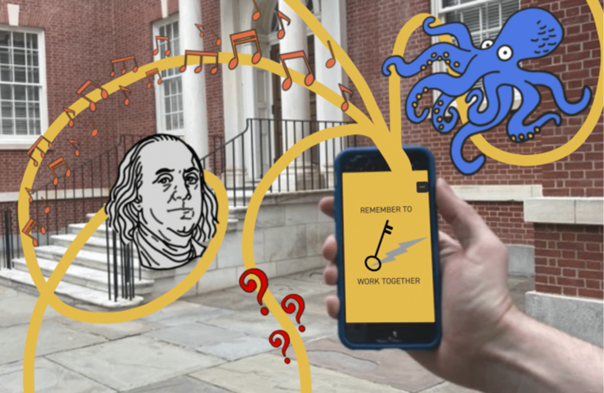
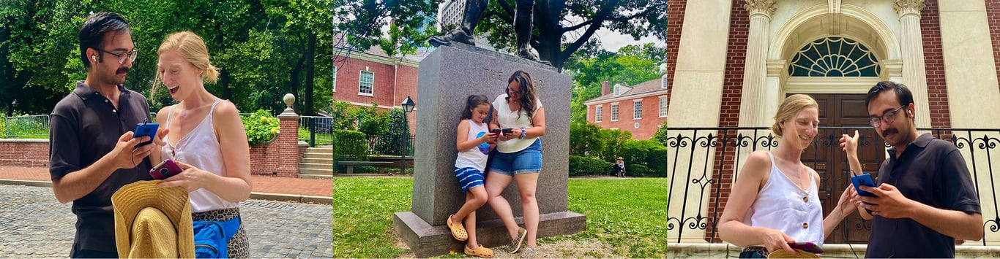
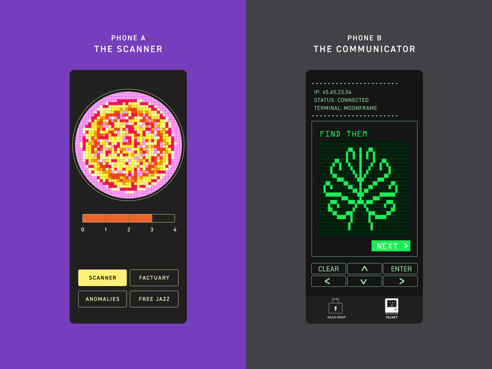
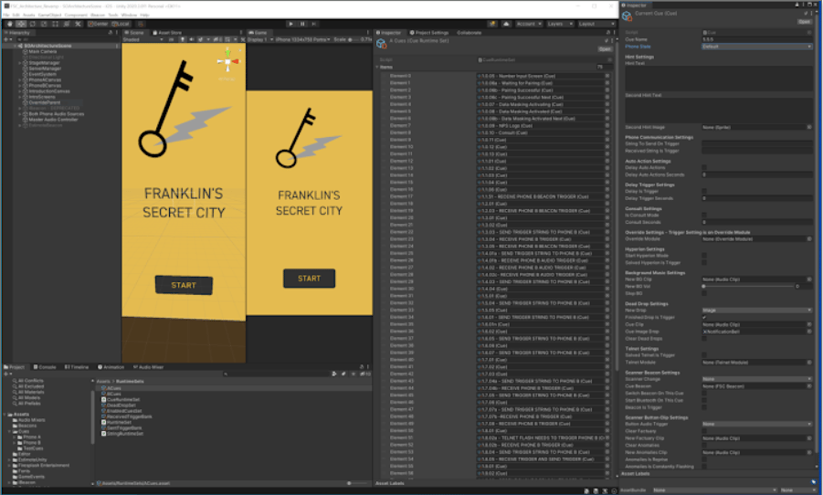
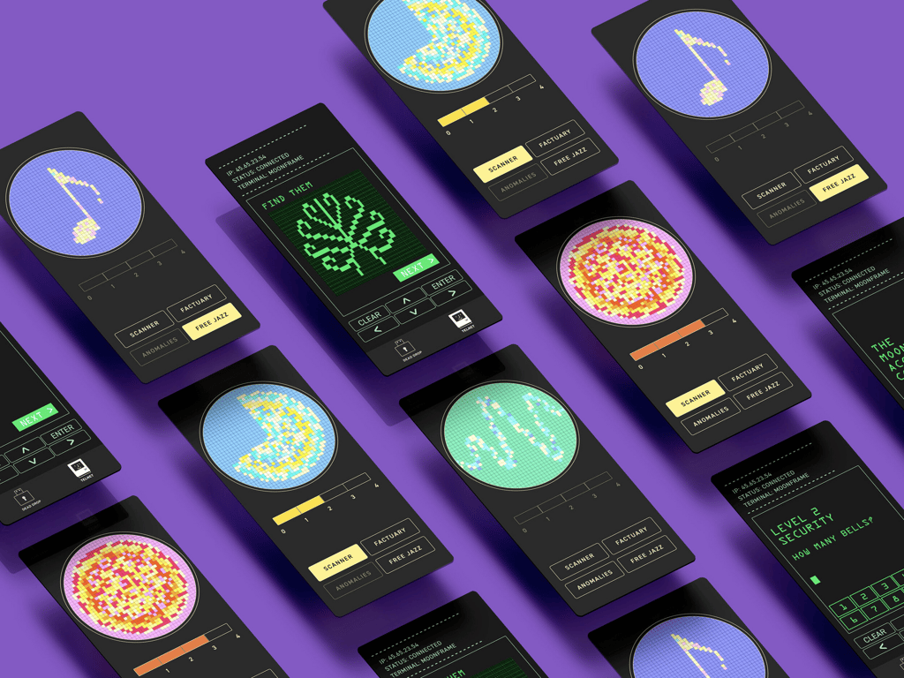

# Franklin’s Secret City

March - May 2021\

::::columns
:::column{width="0.1875"}
## Overview
:::

:::column{width="0.8125"}
Franklin’ Secret City is a site-specific multiplayer mobile augmented reality audio theater experience. The narrative progresses based on the actions taken by the two users’ connected phones as well as Bluetooth beacons which are placed at different locations around the site.

It’s a part walking tour, part scavenger hunt, part immersive audio historical/fantasy mystery,

---
:::
::::

::::columns
:::column{width="0.1875"}
## My role
:::

:::column{width="0.8125"}
I was responsible for prototyping the first version of robot stage manager which would be used to trigger specific UI elements/ audio based on the user’s actions on the mobile app, bluetooth beacon proximity and narrative. I also built the a scanner script that would communicate with the Bluetooth beacons that were in range of the phones and send the live data to the robot stage manager.

---
:::
::::

::::columns
:::column{width="0.2083"}
&nbsp;
:::

:::column{width="0.4167"}
### Team

Pig Iron Theatre.

[Credits](https://pigiron.org/works/franklins-secret-city-now-closed/)
:::

:::column{width="0.375"}
### Key Technologies

Unity: iOS/ Android.
:::
::::

---

::::columns
:::column{width="0.1875"}
## Outcome
:::

:::column{width="0.8125"}
The initial beta test ran from July to September with more than 100 people participating in the experience. The next version is being currently worked upon.

---
:::
::::

::::columns
:::column{width="0.1875"}
## Player Interaction
:::

:::column{width="0.8125"}
Phone A: The scanner phone responds to proximity to bluetooth beacons which changes the audio feed and visuals on screen with minimal text and instructions. Their role is to observe things in the environment.

Phone B: The communicator phone receives most of the instructions and has more on-screen instructions and puzzles which can be solved by the information available to Phone B.

Phone A becomes the driver of the experience but needs to communicate with phone B to further the narrative progression. Phone B is dependent on Phone A to direct their movement through the space and needs to observe the environment for real world and virtual signs that solve the clue to further the narrative.

---
:::
::::

::::columns
:::column{width="0.1875"}
## User Interface
:::

:::column{width="0.8125"}
The UI interactions were programmed in Unity and were triggered based on user action, bluetooth beacon proximity and narrative progression.

:::
::::

::::columns
:::column{width="0.2121"}
&nbsp;
:::

:::column{width="0.25"}
::loop{src="/media/ar-vr/franklin-secret-city/1.mp4" width="250" height="438"}
:::

:::column{width="0.25"}
::loop{src="/media/ar-vr/franklin-secret-city/2.mp4" width="250" height="432"}
:::

:::column{width="0.2879"}
::loop{src="/media/ar-vr/franklin-secret-city/3.mp4" width="250" height="436"}
:::
::::

---

::::columns
:::column{width="0.1875"}
## Visual Design
:::

:::column{width="0.8125"}

UI design team: [Yichan Wang](https://www.yichanwang.me) [Lisa Szolovits](https://lisasz.com)
:::
::::
