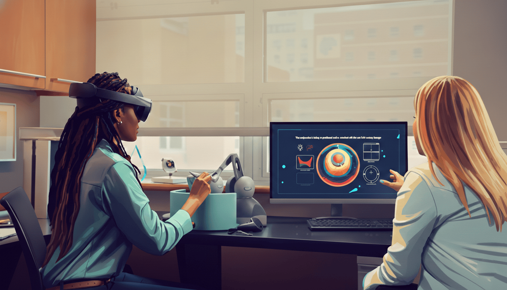

# Fundamental Surgery

Mar 2023 - Aug 2025

::::columns
:::column{width="0.1875"}
## Overview
:::

:::column{width="0.8125"}
Surgical training has traditionally relied on cadavers, live patients, and observation in operating theaters, limiting access and scalability for medical education. Founded in 2012, FundamentalVR is a London-based company pioneering haptic-enabled VR surgical simulation, combining virtual reality with kinesthetic force feedback and soft tissue sensation to translate complex procedures into intuitive learning experiences. The platform is clinically validated through peer-reviewed research and deployed across 30+ countries, serving partners including Royal College of Surgeons, Orbis International, the American Academy of Ophthalmology, and medical device companies like Novartis and Teleflex. FundamentalVR was named one of TIME's Best Inventions of 2018 and Fast Company's Most Innovative Companies in AR/VR for 2025, and has won multiple Auggie Awards including Most Impactful Breakthrough and Best Healthcare & Wellness Solution.

::embed{src="https://www.youtube.com/embed/HYJQ8DzQHY8?rel=0" ratio="56.25"}

---
:::
::::

::::columns
:::column{width="0.1875"}
## My role
:::

:::column{width="0.8125"}
As Principal Designer, I led design and delivery across VR and desktop training platforms, guiding cross-functional teams of junior designers from pitch through production. My hybrid practice spans design, prototyping, and programming in Unity, allowing me to move fluidly between concept and implementation. I built functional prototypes to validate ideas with end users early, and architected systems like visual scripting engines that enabled clinical educators, not just engineers, to author new training scenarios. I established a technical upskilling program in Unity and AI-enabled tools including v0, Bezi, and ShapesXR, building shared capability across the design team.

<u>Role</u>:  UX/UI design, Prototyping, 0→1, User research, mentoring junior designers.

<u>Team</u>:  7 designers, 2 Principals, 30+ engineers.
:::
::::

::::columns
:::column{width="0.1875"}
## Outcome
:::

:::column{width="0.8125"}
This approach was instrumental in securing the £5M AAO contract, resulting in the first VR eye surgery training application on the Meta Quest App Store, now accessible to over 32,000 surgeons globally. The upskilling program reduced implementation time by 20%. My 0-1 research on AI-powered virtual tutors and generative anatomy tools is now in beta testing with medical professionals to support new client acquisition.

*Full case studies available upon request due to NDAs and unreleased work.*

::embed{src="https://www.youtube.com/embed/tfixIY8SKkM?rel=0" ratio="56.25"}
:::
::::
