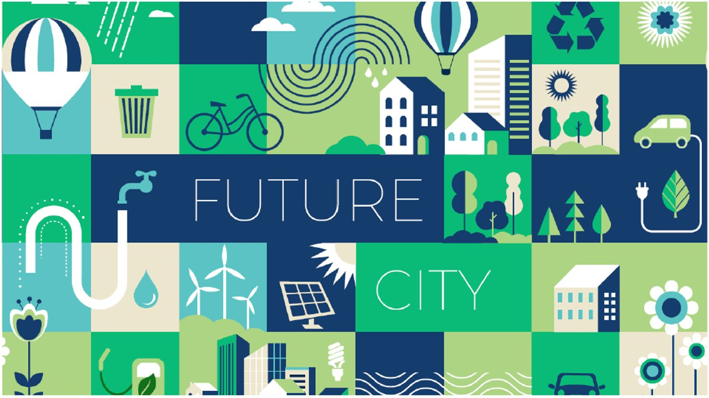
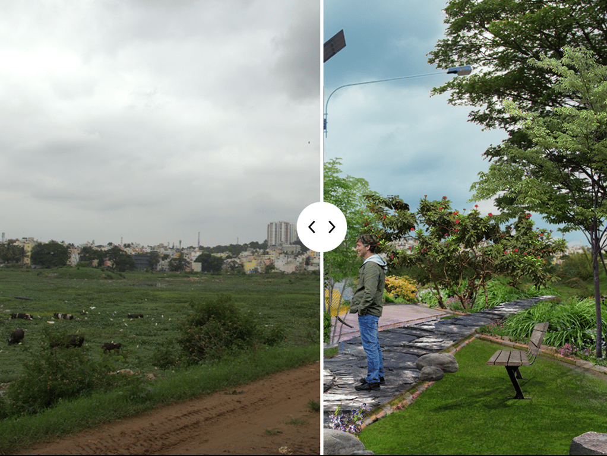
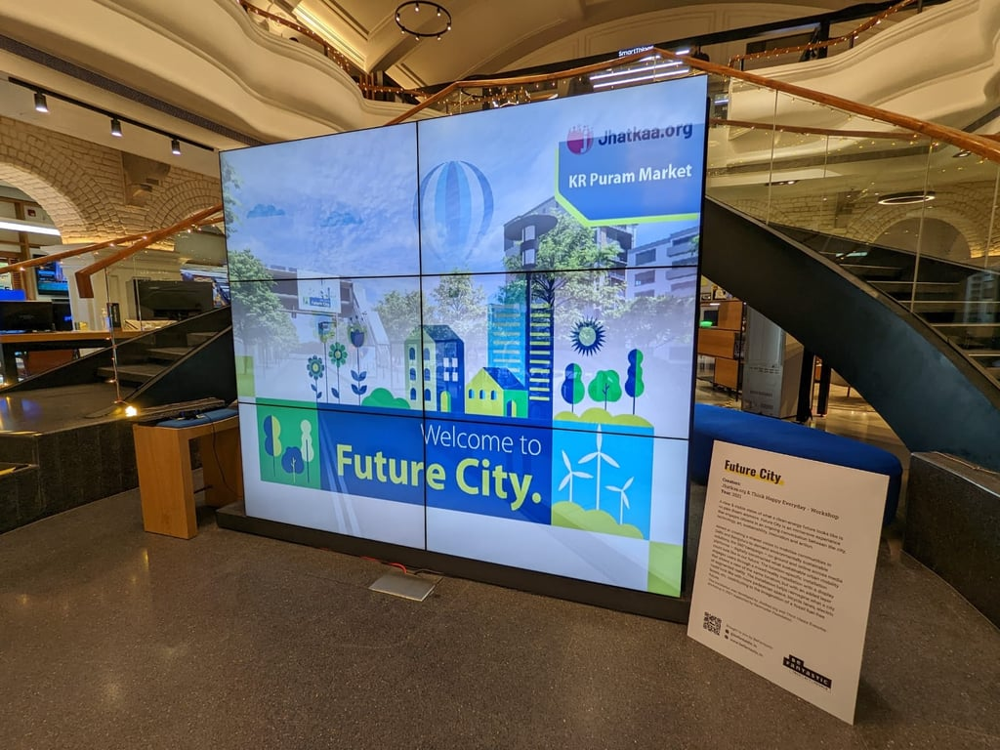
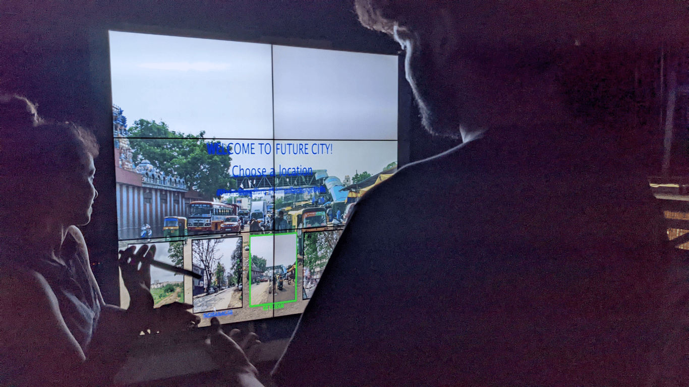
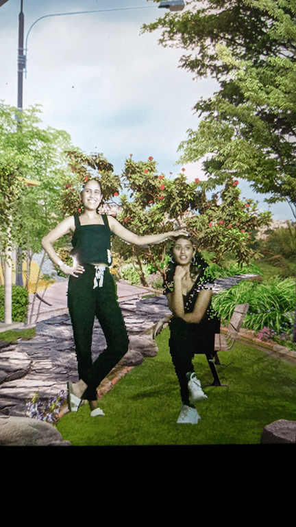
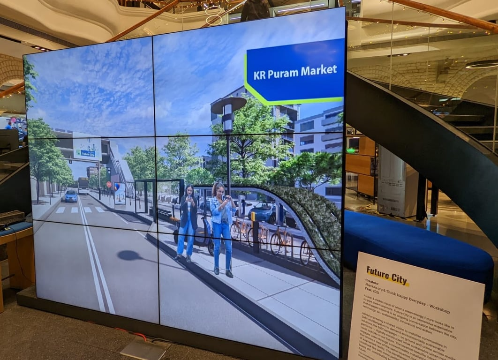
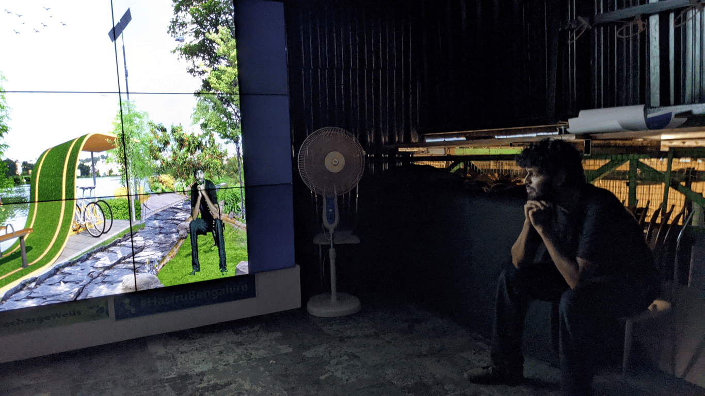

# Future City: Visions of a green future

December 2021 - Ongoing\

::::columns
:::column{width="0.1875"}
## Overview
:::

:::column{width="0.8125"}
Future City: Visions of a green future is an initiative by social advocacy group [Jhatkaa.org](http://Jhatkaa.org) to rally support for mobilizing residents of Indian cities to demand a cleaner, better future. It is a series of Augmented Reality Installations where viewers are transported into a future city that offers better amenities such as specific cycle lanes, EV charging points, blue skies, and green zones; thereby showcasing the possibility of an eco-friendly future.

::embed{src="https://www.youtube.com/embed/HS_HbmIZyRE?rel=0" ratio="56.25"}

---
:::
::::

::::columns
:::column{width="0.1875"}
## My role
:::

:::column{width="0.8125"}
I was responsible for defining the technology framework of the installation, which included power, electrical infrastructure, and the software stack. Furthermore, I programmed the first prototype and managed the installation process.
:::
::::

::::columns
:::column{width="0.2083"}
&nbsp;
:::

:::column{width="0.4167"}
### Team

[Jhatkaa.org](http://www.jhatkka.org): Client and on-ground operations.

[THE Workshop](https://the-workshop.in/): Design & Fabrication
:::

:::column{width="0.375"}
### Key Technologies

Tensorflow.js (BodyPix), Unity, Kinect.
:::
::::

---

::::columns
:::column{width="0.1875"}
## Images
:::

:::column{width="0.8125"}

:::
::::

---

::::columns
:::column{width="0.1875"}
## Press
:::

:::column{width="0.8125"}
The installation was covered by major Indian newspapers and installed at multiple venues across the country:

[Times of India](https://bangaloremirror.indiatimes.com/bangalore/civic/the-time-machine/articleshow/91501414.cms)

[Bangalore Mirror](https://bangaloremirror.indiatimes.com/bangalore/others/bengaluru-reimagined/articleshow/91970500.cms)
:::
::::
