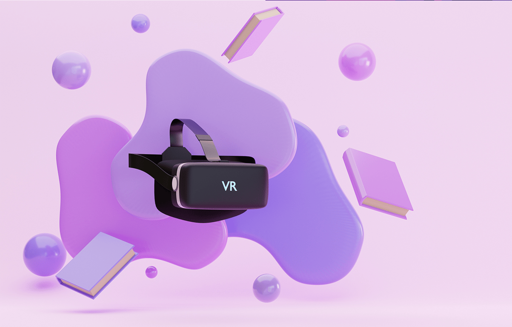
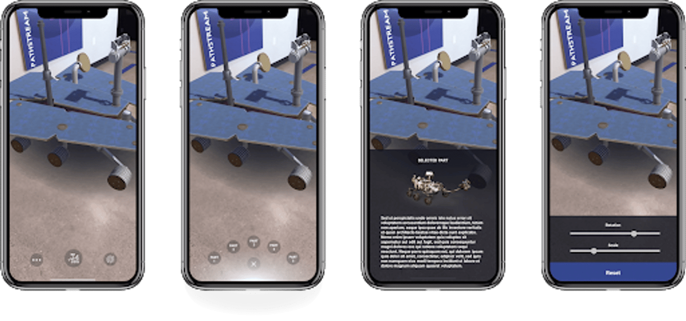

# Unity Immersive Design

Jan - Aug 2021\

::::columns
:::column{width="0.1875"}
## Overview
:::

:::column{width="0.8125"}
The Unity Immersive Design certificate is a 12-week program to equip students with hands-on experience to create highly realistic, immersive and interactive virtual scenes. Using Unity, Students learn to build interactive, standalone AR/VR applications with realistic objects, audio, 2D and 3D assets, custom animations, responsive, interactive UI, and basic scripting for locomotion techniques.

---
:::
::::

::::columns
:::column{width="0.1875"}
## My role
:::

:::column{width="0.8125"}
I was the online instructor for both AR and VR modules from Jan to August 2021 working with around 100 students. My responsibilities included running course content review sessions, conducting office hours and helping students debug their unity projects.

---
:::
::::

::::columns
:::column{width="0.25"}
## AR Module Interaction Demos
:::

:::column{width="0.75"}

:::
::::

::::columns
:::column{width="0.25"}
&nbsp;
:::

:::column{width="0.375"}
::loop{src="/media/ar-vr/unity-immersive/ezgif-3-4ddfcb73155e.mp4" width="600" height="1299"}

::loop{src="/media/ar-vr/unity-immersive/ezgif-6-53ec28e4a40611.mp4" width="600" height="1300"}

::loop{src="/media/ar-vr/unity-immersive/image4.mp4" width="1026" height="786"}
:::

:::column{width="0.375"}
::loop{src="/media/ar-vr/unity-immersive/01.mp4" width="600" height="1299"}

::loop{src="/media/ar-vr/unity-immersive/trim-01.mp4" width="354" height="768"}

::loop{src="/media/ar-vr/unity-immersive/image2.mp4" width="920" height="796"}
:::
::::

---

::::columns
:::column{width="0.25"}
## VR Module Interaction Demo
:::

:::column{width="0.75"}
::embed{src="https://www.youtube.com/embed/FhBhsBWWC8c?feature=oembed" ratio="56.20608899297424"}
:::
::::
