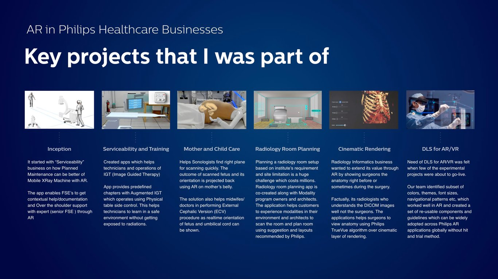
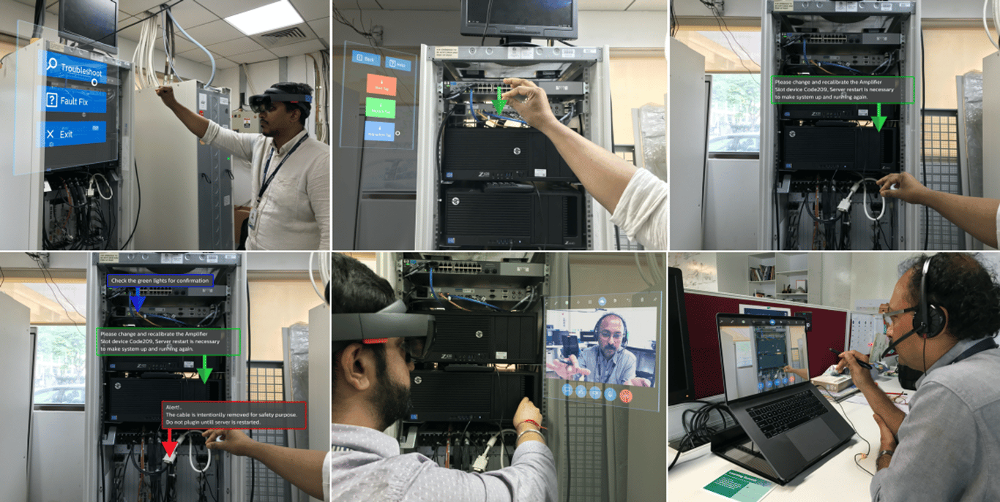
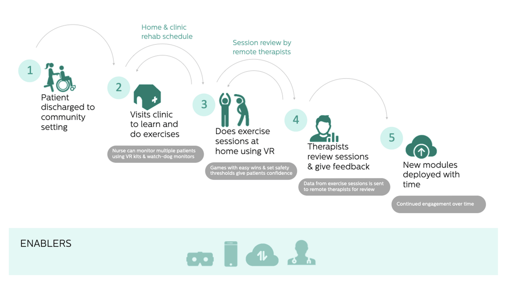
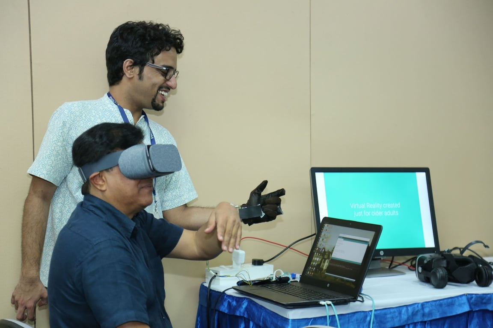
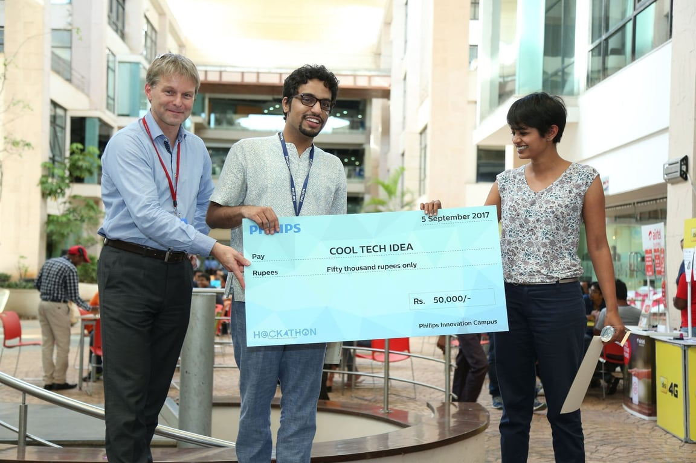

# XR@Philips: Frontiers of Healthcare

July 2017 - May 2018\

::::columns
:::column{width="0.1875"}
## Overview
:::

:::column{width="0.8125"}
Frontiers in Healthcare was initiated by the Design Innovation Program at Philips in 2017 to build AR/VR competency in the organization. I was a part of the initial design team in Bangalore designing and prototyping AR/VR experiences for several business categories in Healthcare.

---
:::
::::

::::columns
:::column{width="0.1875"}
## My role
:::

:::column{width="0.8125"}
I was responsible for collaborating with teams from various businesses to identify opportunity areas where XR could bring value. I helped define the user experience flows of the initial prototypes across a range of devices (HoloLens, VR headsets, Google Cardboard), and programmed key user interactions before hand-off to development. I also anchored quarterly initiatives for sharing knowledge gained from these projects with the the Design Language system team and Philips Design community.

---
:::
::::

::::columns
:::column{width="0.1875"}
## Outcomes
:::

:::column{width="0.8125"}
The trial prototypes and projects served as examplars for developing a framework that would enable Philips Design to deliver XR projects across multiple businesses. The insights from usability testing and research with end-users contributed to the development of reusable components and guidelines the Design Language System for AR/VR that could be widely adopted across the organization.

---
:::
::::

::::columns
:::column{width="0.2083"}
&nbsp;
:::

:::column{width="0.4167"}
### Team

4 Designers.

5+ Engineering.
:::

:::column{width="0.375"}
### Key Technologies

Unity, Vuforia, Rhino.
:::
::::

---

### *Full case studies available upon request due to NDAs and unreleased work.*

::::columns
:::column{width="0.1875"}
## Sample Interfaces
:::

:::column{width="0.8125"}

The user interactions were prototyped using Vuforia and Unity and deployed the Microsoft HoloLens.
:::
::::

---

::::columns
:::column{width="0.1875"}
## VR Prototypes
:::

:::column{width="0.8125"}
With the emergence of stand-alone VR devices in 2016, new opportunities for delivering care opened up for the healthcare industry. I co-led a small team which worked on a business case for Philips to invest in long-term rehabilitation solutions and built proof of concept prototypes to demonstrate the ideas. The ideas were well-received and was awarded with an award and an internal hackathon and the work was presented to various businesses to help them understand and leverage VR in the current suite of solutions.

The proof of concept demos were created using off the shelf hardware that were interfacing with Unity via bluetooth. We spoke to experts in rehabilitation therapy to find out the various exercises a person goes through during rehabilitation and created 3 demos as follows:

‘<u>Expanding range of motion’ prototype</u>:

Using a glove that was hacked together with an Arduino, force sensor and circuit from a VR controller, this demo focuses on how this technology can help patients build hand strength. Patients squeeze a stress ball while wearing the glove and based on the strength applied on the glove, the speed of the bullet changes. The goal of the game is to burst the balloons with bullets at an appropriate speed and over the course of the game, the patients spend about 10-15 minutes which is a recommended duration of the exercise.

::embed{src="https://www.youtube.com/embed/IA-3Zcz9o4A?feature=oembed" ratio="56.20608899297424"}

<u>‘Limited motion’ prototype</u>:

This demo was built to show how exercises could be designed for patients who were experiencing very limited mobility and facial paralysis. The VR headset was combined with a sensor that detected muscle movement near the eyelid to detect a wink. The gameplay experience consisted of a jigsaw puzzle where patients would pick up pieces by winking at them and then winking again to place them on the puzzle surface.

::embed{src="https://www.youtube.com/embed/r87Xj-FAdtE?feature=oembed" ratio="56.20608899297424"}

<u>‘Attention’ prototype</u>:

Patients who have experienced massive paralysis or loss in mobility also report brain fog and have trouble focusing. This demo was created to show how VR headsets can be combined with off-the-shelf EEG sensors to build games that serve as a gym for building focus and attention.

::embed{src="https://www.youtube.com/embed/eMBeA1emkwg?feature=oembed" ratio="56.20608899297424"}

The project was rewarded with an award and a money grant to develop it further so that i could be integrated with existing Philips businesses.

:::
::::
