# NYU-Ability Lab

September 2019 - December 2021

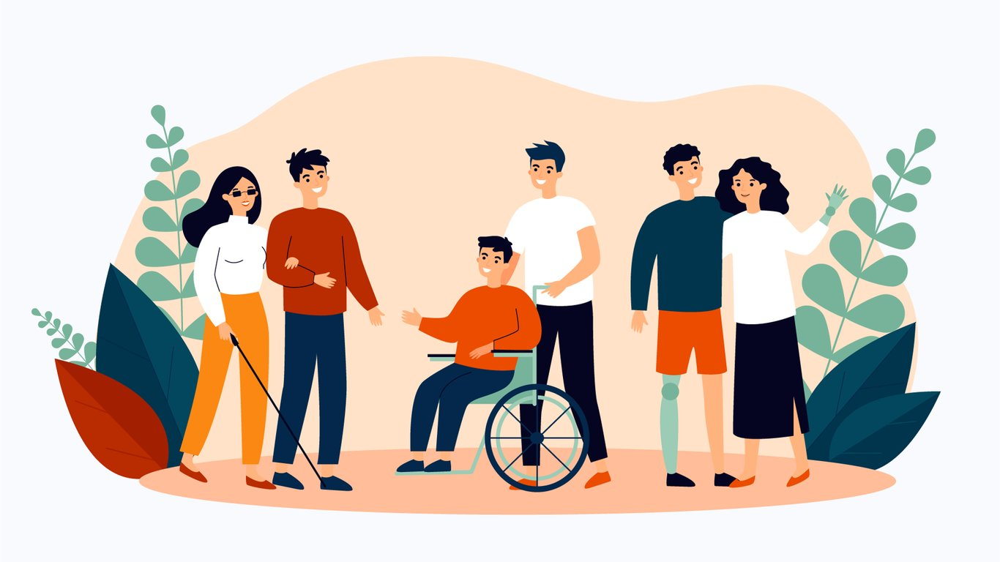

::::columns
:::column{width="0.1875"}
## Overview
:::

:::column{width="0.8125"}
The Ability Lab is an interdisciplinary research space dedicated to the intersection between disability and technology. It fosters collaboration between individuals with disabilities and engineers, designers, educators, artists, occupational and physical therapists and speech language pathologists.

---
:::
::::

::::columns
:::column{width="0.1875"}
## My role
:::

:::column{width="0.8125"}
I was involved in the design and development of multiple projects around accessible interfaces, spaces, and learning tools for humans with sensory, mobility and cognitive disabilities.
:::
::::

::::columns
:::column{width="0.2083"}
&nbsp;
:::

:::column{width="0.4167"}
### Team

[NYU Ability Lab](https://wp.nyu.edu/ability/team/)
:::

:::column{width="0.375"}
### Key Technologies

Arduino

Raspberry pi
:::
::::

:::::columns
:::column{width="0.1875"}
## Projects
:::

::::column{width="0.8125"}
<u>Non-visual soldering workshop</u>:

Blind and low vision learners are underrepresented in STEM and maker culture, both of which are historically inaccessible. I was a part of the team that designed and evaluated a non-visual soldering curriculum with a three-day workshop. My primary role was working with workshop lead, Dr. Joshua Miele (MacArthur Fellow 2021) to ensure that all the workshop material and pre-built circuits were in place and assisting workshop participants with verbal instructions to build their confidence with the material during the workshop.

The findings from this workshop helped define a research project that would convert data from microcontroller-based soldering irons and measuring tools into audio prompts using text to speech algorithms so that these tools become more inclusive for blind users.

[Read project details.](https://wp.nyu.edu/ability/nonvisual-soldering-workshop-at-itp/)

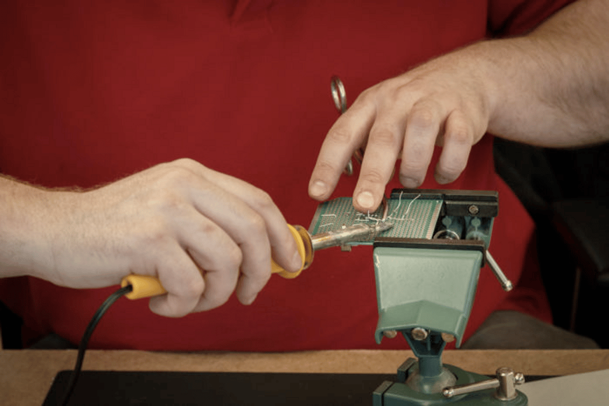

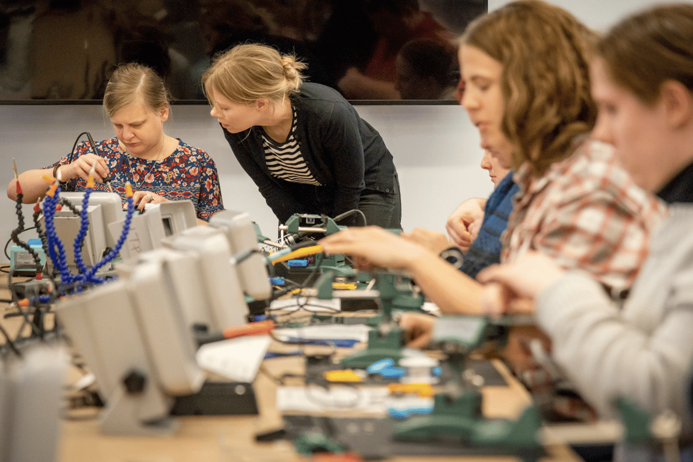

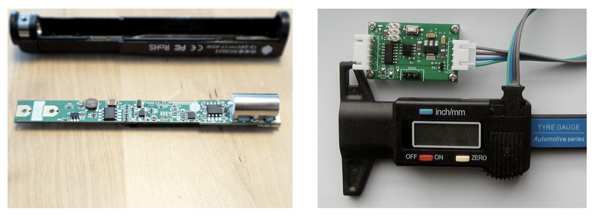

<u>Open-source adaptive gaming controller</u>:

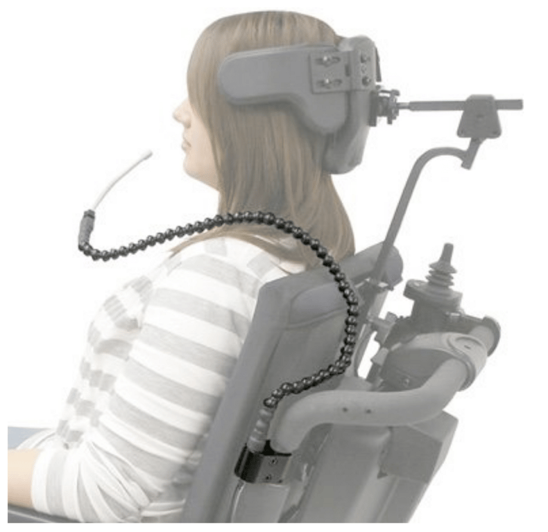

Switch-it is a customizable, adaptive gaming controller for people with limited mobility. Created in collaboration with NYU Langone Medical Center, Switch-it was designed to making gaming more accessible to disabled gamers and making gaming more inclusive for a wide range of abilities. It consists of two parts: 1) An open source hardware design that has multiple inputs for other buttons, switches and levers from outside adaptive video game control manufacturers. 2) An open-source software which allows users to customize the inputs and bind them to specific keystrokes.

The first prototype was awarded a grant by the [NYU HealthTech transformer challenge](https://engineering.nyu.edu/research-innovation/entrepreneurship/nyu-healthtech-transformer-challenge) and the hardware and software is currently under active development.

::bookmark{url="https://youtube.com/shorts/PR5lJNBhgPU" title="Switch-it"}

::embed{src="https://www.youtube.com/embed/5zYWd2bgE6M?feature=oembed" ratio="56.20608899297424"}

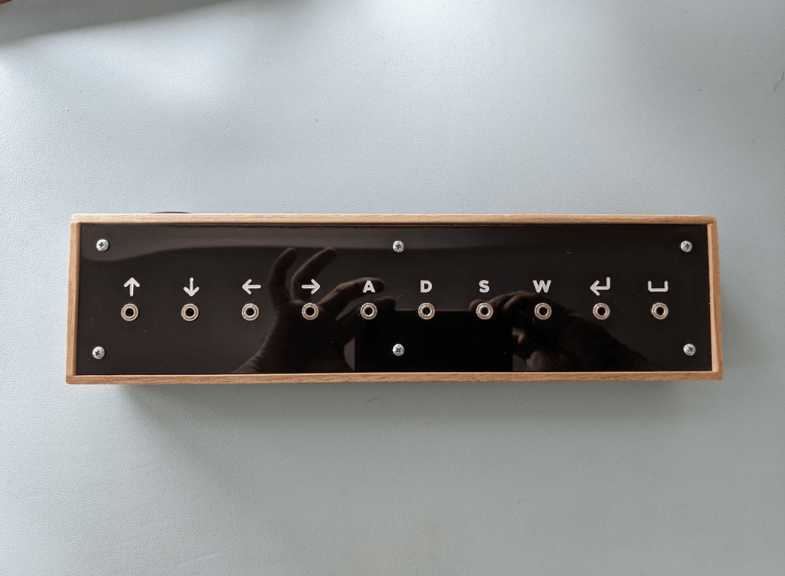

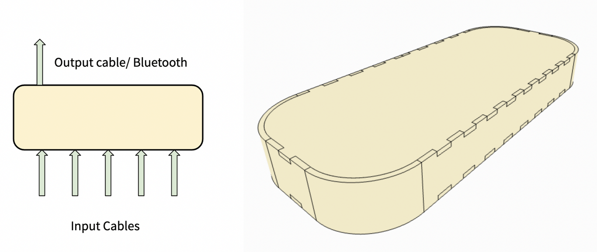

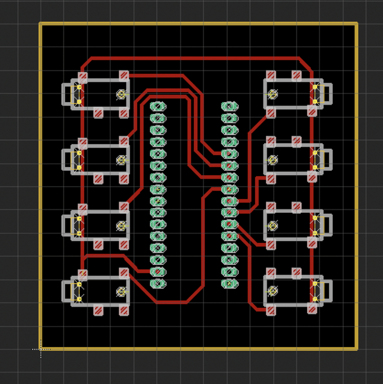

<u>Multisensory room- NYU Oral Health Center</u>:

New York University Dentistry’s Oral Health Center and the NYU Ability Project created a multi-sensory room with soft color-changing lights, a large mat, weighted blankets, a solitude-enabling chair and more to help those with mental and emotional disabilities relax before, during, and after their oral health care appointments at the center.

I was responsible for setting up the technical architecture of the projection system and LED patterns where visualizations programmed in p5.js could be sent to a raspberry pi which cued up the patterns/ visualizations on the projection and LED systems.

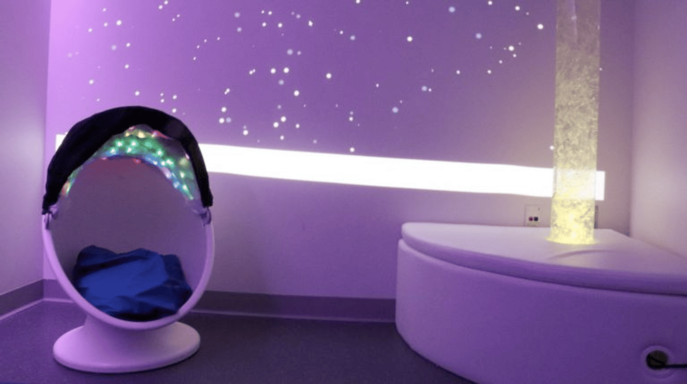

:::figure{width="192"}
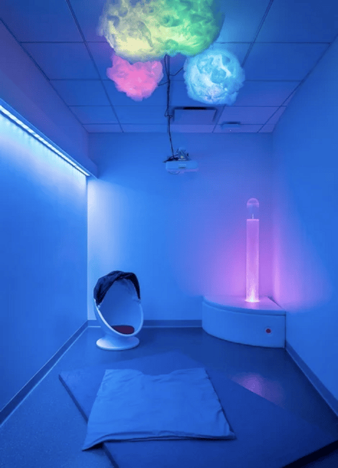
:::

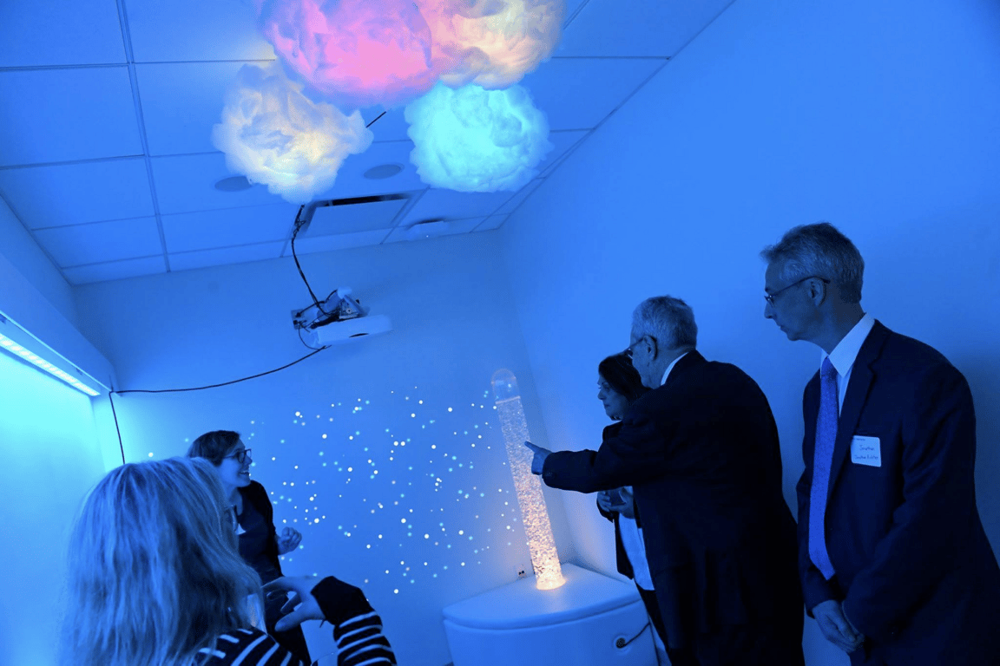
::::
:::::
