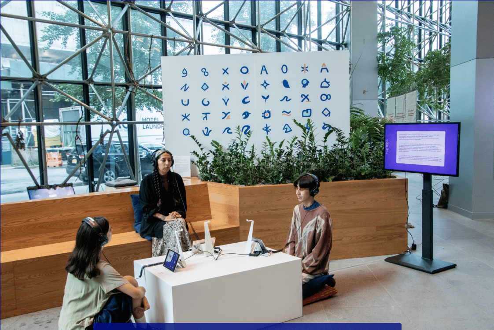
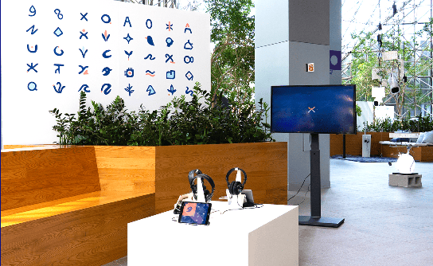
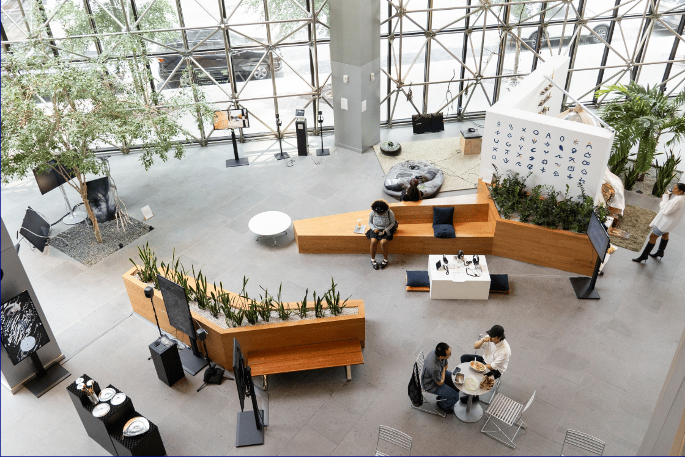
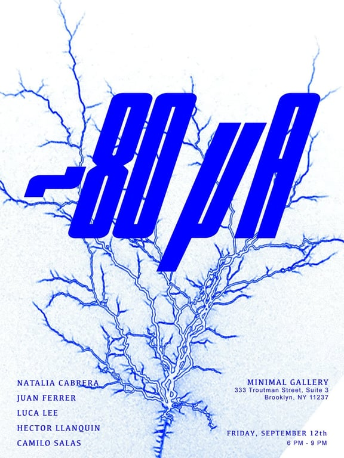

# Becoming L

December 2024 - May 2025

::::columns
:::column{width="0.1875"}
## Overview
:::

:::column{width="0.8125"}
Becoming L is an ongoing human-AI collaboration and multimedia experience exploring the dialogue between two versions of the same persona: L, an artificially intelligent being representing trans-artist Luca's former pre-transition self, and their present identity. The installation presents an immersive, multilayered audio piece featuring a conversation between a voice model trained on Luca's pre-transition voice and their current voice.

---
:::
::::

::::columns
:::column{width="0.1875"}
## My role
:::

:::column{width="0.8125"}
I was responsible for training creating the AI voice models using three open-source models and tools. (StyleTTS 2, Coqui's XTTS-v2, and Chatterbox). Since the source audio constituted intimate personal data, the training was done on offline, local systems instead of using commercial tools.
:::
::::

::::columns
:::column{width="0.2083"}
&nbsp;
:::

:::column{width="0.4167"}
### Team

Luca Lee (Lead Artist)
:::

:::column{width="0.375"}
### Key Technologies

Kokoro TTS

StyleTTS 2

ChatterBox

XTTS-v2
:::
::::

::::columns
:::column{width="0.1875"}
## Exhibits
:::

:::column{width="0.8125"}
---

## [Demo Day 2025, NEW Inc., New York](https://www.demofestival.org/showcases/extended-realities)

## [Minimal Gallery, New York](https://www.minimalnycgallery.com/80ua)

:::
::::

::::columns
:::column{width="0.1875"}
## Output
:::

:::column{width="0.8125"}
This collaboration produced the following dialogue-based audio works, each constructed through iterative exchanges between the synthetic voice model and Luca's present voice. The source material for L's voice was assembled from preserved digital fragments: old voice notes, video recordings, and archived audio spanning years prior to transition. These artifacts, never intended as training data, were repurposed into a corpus from which the model could learn the particular rhythms, inflections, and timbre of a voice no longer spoken. The trained model was then used through both text-to-speech synthesis and voice cloning over current recordings, with the resulting outputs carefully curated and edited to shape the final piece.

::embed{src="https://w.soundcloud.com/player/?visual=true&url=https%3A%2F%2Fapi.soundcloud.com%2Fplaylists%2F2031832236&show_artwork=true" height="450" width="500"}
:::
::::
