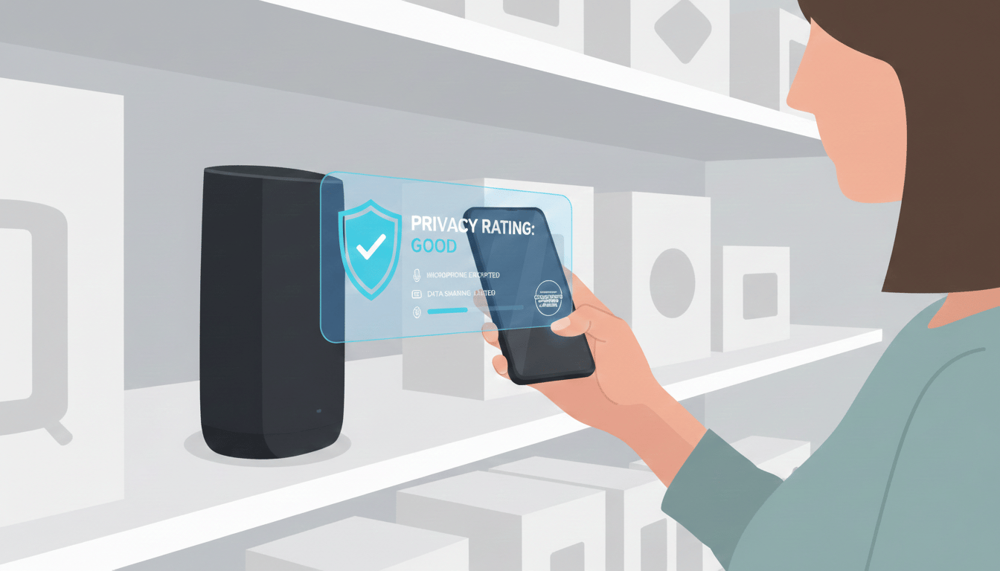
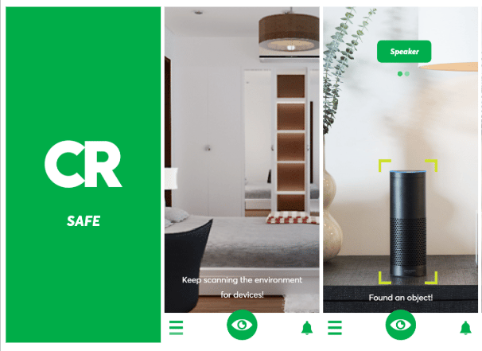

# The Box

January - March 2021

::::columns
:::column{width="0.1875"}
## Overview
:::

:::column{width="0.8125"}
Most consumers have no idea how the devices they buy handle their data. Privacy policies are buried, hard to read, and rarely consulted in the moment of purchase. This project explored whether augmented reality could change that. Commissioned through an NYC Media Lab seed grant with Consumer Reports, we built an AR prototype that lets users point their phone at a device in a store and instantly see its privacy rating. The key innovation was training custom vision models on Consumer Reports' product image database and connecting it to Mozilla's Privacy Not Included initiative to surface privacy information in real time.

---
:::
::::

::::columns
:::column{width="0.1875"}
## My role
:::

:::column{width="0.8125"}
I wrote the initial grant proposal and led product design, defining the user experience and interaction model. I also helped train the prototype demo dataset, working with Consumer Reports' image library to build out the vision model's recognition capabilities.

::embed{src="https://www.youtube.com/embed/1wBNARlJOg0?rel=0" ratio="56.25"}

---
:::
::::

::::columns
:::column{width="0.2083"}
&nbsp;
:::

:::column{width="0.4167"}
### Team

Brent Bailey

Matthew Ross
:::

:::column{width="0.375"}
### Key Technologies

Custom Image Classifier on CoreML, Swift
:::
::::

---

::::columns
:::column{width="0.1875"}
## Working Prototype
:::

:::column{width="0.8125"}
<!-- missing image: image52 (restore from the Notion export) -->

<!-- missing image: image47 (restore from the Notion export) -->

::loop{src="/media/creative-tech/cr-safe/image25.mp4" width="600" height="428"}

<!-- missing image: image51 (restore from the Notion export) -->

:::
::::
