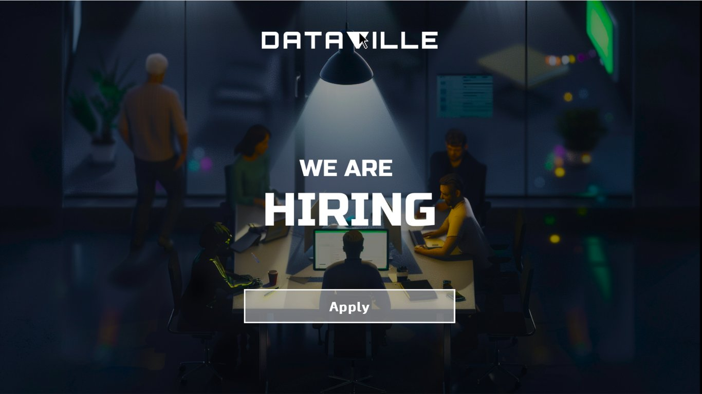
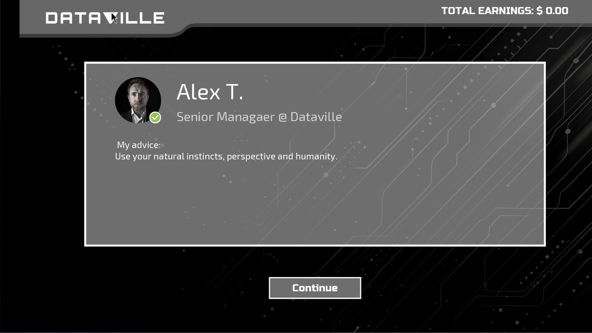
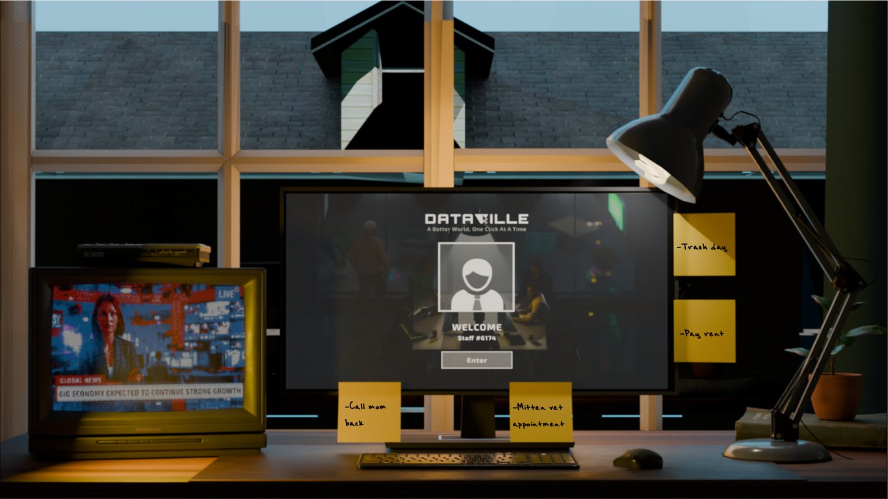
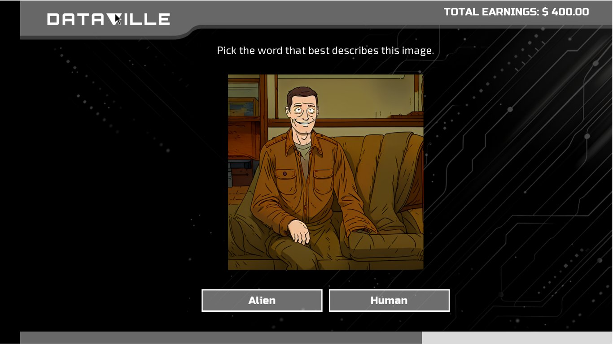
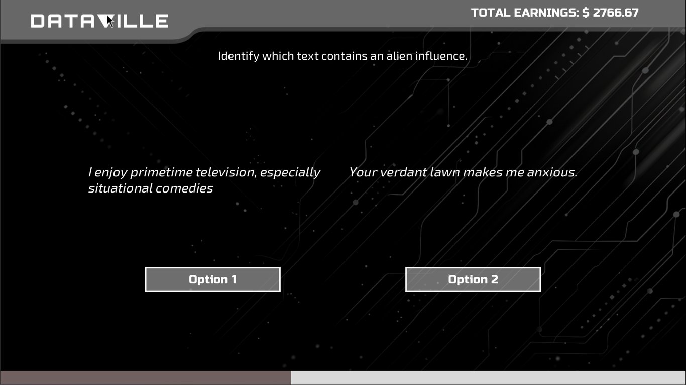
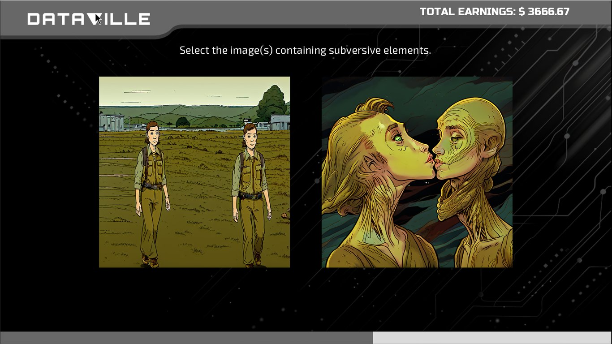
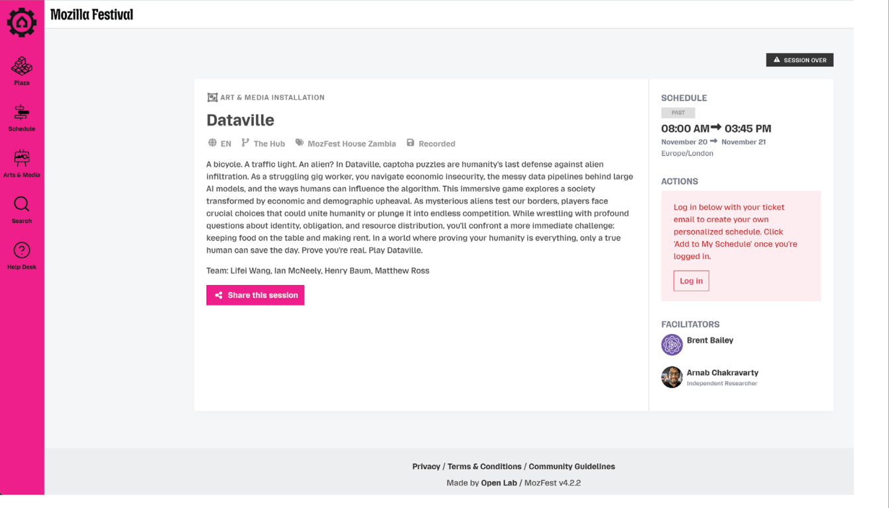
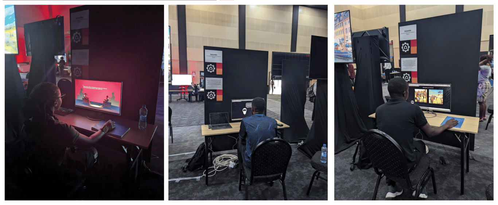

# Dataville

January - November 2024

::::columns
:::column{width="0.1875"}
## About
:::

:::column{width="0.8125"}
Dataville is a visual novel exploring the invisible labor behind AI systems. Set in an alternate present where Earth faces a refugee crisis from outer space, the game puts players in the role of a gig worker hired to label data for a data labeling company.\
As players complete mundane verification tasks to pay rent and stay fed, their choices shape how the AI model behaves, and in turn, how society treats its newest members. The game examines how data labelers, often underpaid and overlooked, can have as much influence on AI systems as the researchers designing them. Dataville asks who gets to belong, who decides, and what it costs to constantly prove your humanity.

Dataville was developed with support from Mozilla and received the Mozilla Creative Media Award.

[\[Mozilla Creative media award winner\]](https://www.mozillafoundation.org/en/blog/announcing-11-projects-exploring-ai-and-responsible-design/)

### Play the Game:

::bookmark{url="https://hellagrapes.itch.io/dataville" title="Dataville" description="How unseen labor affects AI."}

---
:::
::::

::::columns
:::column{width="0.1875"}
## My role
:::

:::column{width="0.8125"}
I was responsible for securing the initial grant and building the team, setting the creative and conceptual direction, conducting background research, and developing the custom AI image generation models.
:::
::::

::::columns
:::column{width="0.2083"}
&nbsp;
:::

:::column{width="0.4167"}
### Team

Brent Bailey

Ian McNeely

Lifei Wang

Henry Baum

Matthew Ross
:::

:::column{width="0.375"}
### Key Technologies

RenPy

StableDiffusion
:::
::::

::::columns
:::column{width="0.1875"}
## Screens
:::

:::column{width="0.8125"}

:::
::::

::::columns
:::column{width="0.1875"}
## Exhibits
:::

:::column{width="0.8125"}
Dataville was exhibited at Mozfest Africa 2024, where it was shown to representatives from African non-profits working to ensure fair wages and rights for data labelers. The project is currently seeking funding to develop into a full game.

:::
::::
