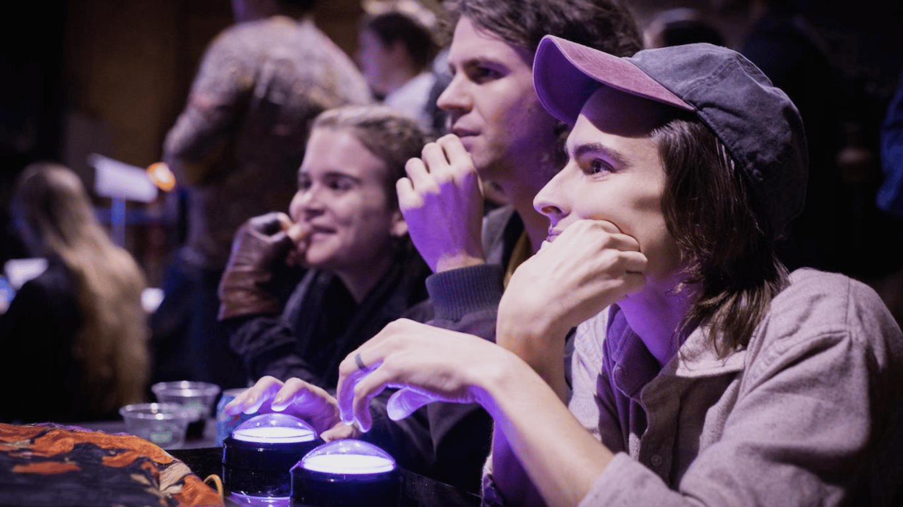
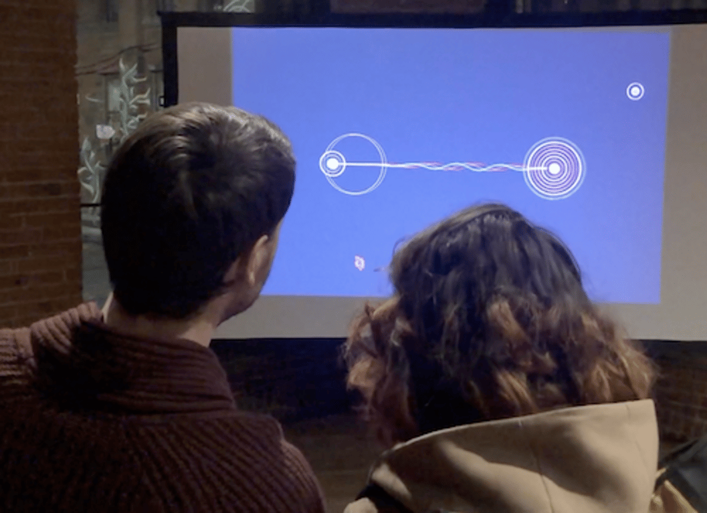

# Follow: A two player cooperative game

September - November 2019

::::columns
:::column{width="0.1875"}
## Overview
:::

:::column{width="0.8125"}
Follow is a two player cooperative game, with a custom controller. Follow explores the space of leading/following, the intimacy of opposition, and the delicate balance of shared control.

“Is there intimacy in opposition? How do we move together when we lead and follow?”

---
:::
::::

::::columns
:::column{width="0.1875"}
## My role
:::

:::column{width="0.8125"}
Marie LeBlanc Flanagan was the creative head and lead artist of this project. I was responsible for the fabrication and micro-controller programming of the custom game controller.
:::
::::

::::columns
:::column{width="0.2083"}
&nbsp;
:::

:::column{width="0.4167"}
### Team

[Marie LeBlanc Flanagan](https://marieflanagan.com)
:::

:::column{width="0.375"}
### Key Technologies

Arduino

P5.js
:::
::::

::::columns
:::column{width="0.1875"}
## Exhibits
:::

:::column{width="0.8125"}
---

Follow was show-cased at [No:Quarter Exhibition](https://gamecenter.nyu.edu/events/no-quarter/) 2019.

::embed{src="https://www.youtube.com/embed/3t13XOceq0Q?feature=oembed" ratio="56.20608899297424"}
:::
::::

::::columns
:::column{width="0.1875"}
## How Follow works
:::

:::column{width="0.8125"}
- 
- 
- 
- 
- 
- 
- 
-
:::
::::
