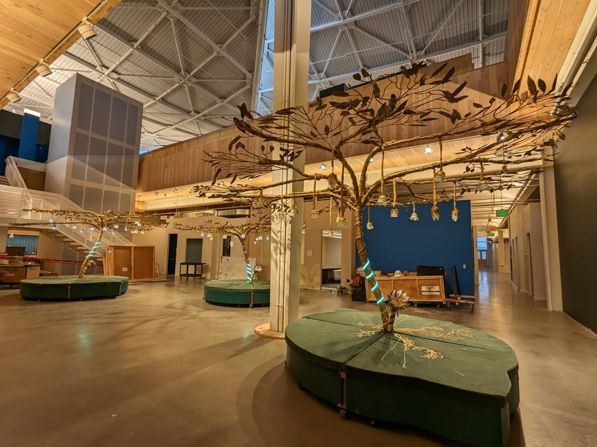
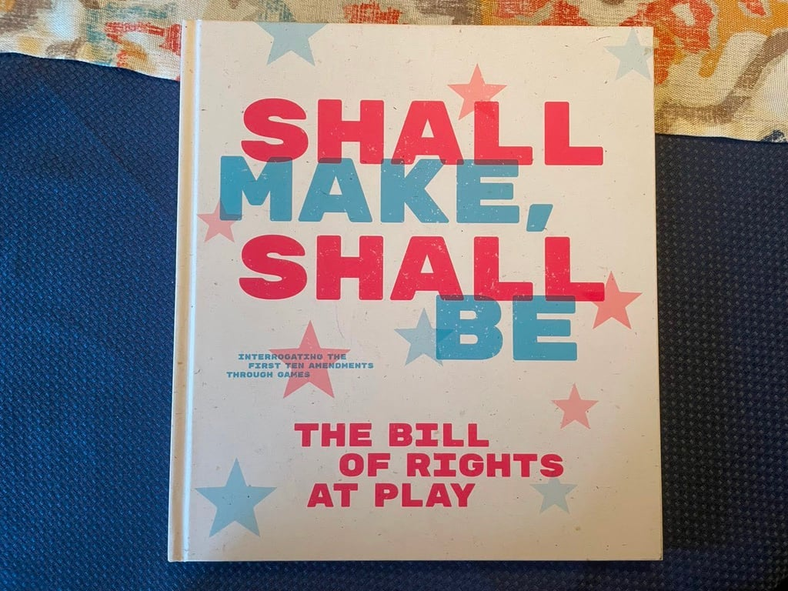

# Pulse & Bloom

2021 - 2022

::::columns
:::column{width="0.1875"}
## About
:::

:::column{width="0.8125"}
*Verbal Gymnastics* is a single-player, motion-activated arcade game in which players find themselves having to perform their innocence for a jury of creatures. Dressed quite regally, perhaps in a nod to the interpretation of “common law” based on seventeenth-century English law, the Verbal Gymnastics jurors bring with them the idiosyncrasies one might expect from a jury. Players enact their innocence before the jury by performing a series of requested hand gestures. Jurors then interpret the player’s truthfulness and pass judgment accordingly.

[Website](https://shallmakeshallbe.org/index.html)

[Exhibit](https://federalhall.org/programs/reflections-on-democracy/)

[Book](https://www.barnesandnoble.com/w/shall-make-shall-be-laine-nooney/1143035570)

:::
::::

::::columns
:::column{width="0.1875"}
## My role
:::

:::column{width="0.8125"}
I spearheaded the entire project, serving as the driving force behind the initial concept development. As the lead programmer, technical director, and producer, I oversaw and contributed to various aspects of the project's execution. Additionally, I took charge of the grant-writing process, managed the construction of the arcade cabinet, and supervised the installation of the exhibit at Federal Hall in Manhattan. Over the course of a month, the exhibit garnered visibility from more than 1000 individuals.
:::
::::

---

::::columns
:::column{width="0.1875"}
## Details
:::

:::column{width="0.8125"}
### Interaction loop

::video{src="/media/creative-tech/hardware-installations/whatsapp-video-2026-05-27-at-17-47-52.mp4" width="523"}

::video{src="/media/creative-tech/hardware-installations/whatsapp-video-2026-05-27-at-17-47-52-1.mp4" width="523"}

::video{src="/media/creative-tech/hardware-installations/whatsapp-video-2026-05-27-at-17-47-52-2.mp4" width="523"}

### Build and installation

The exhibit was also featured in the accompanying publication:\
[Shall Make, Shall Be: The Bill of Rights at Play](https://www.amazon.com/Shall-Make-Be-Bill-Rights/dp/B0BV63Y8ZX).

:::
::::
