# J.E.S.S. (Just examining systemic stereotypes)

June 2024 - February 2025

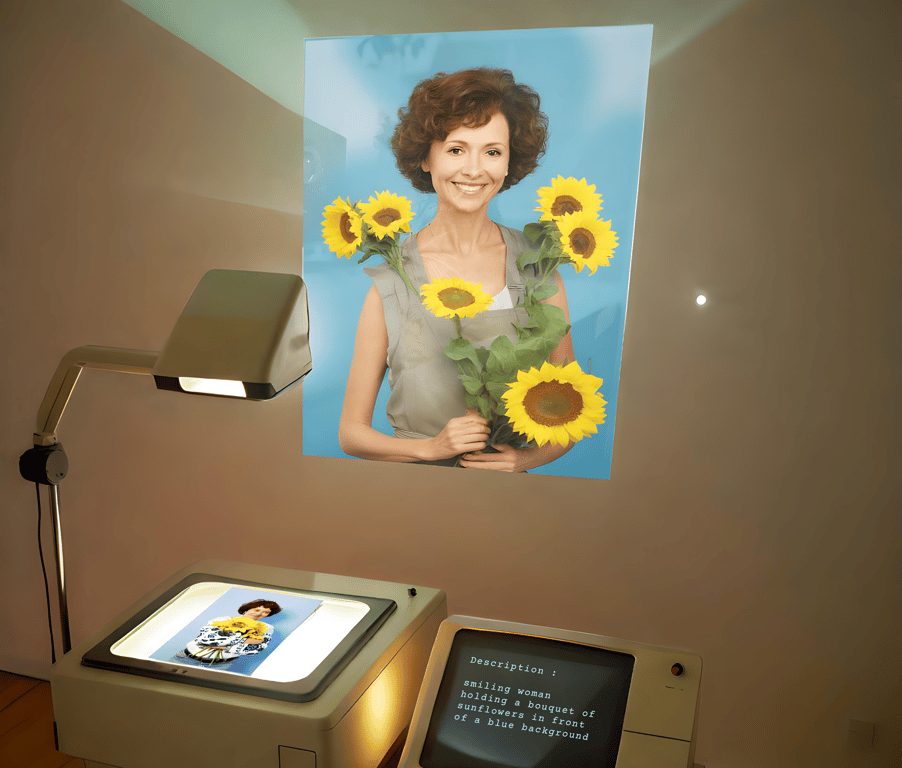

::::columns
:::column{width="0.1875"}
## About
:::

:::column{width="0.8125"}
J.E.S.S. is an interactive installation that sparks curiosity and invites playful, hands-on exploration of how Al models interpret people. Situated within an exhibition exploring photography’s evolution, the installation invites viewers to interact with nostalgic tools — a hybrid of a projector and a scanner. Participants select photographs of the local community taken by human photographers and feed them into the machine.

The Al image-to-text model translates the visuals into words. It displays them on a monitor for visitors to read. This collection of disconnected phrases and isolated terms then serves as a prompt for an Al text-to-image model to try to recreate the photograph. This step-by-step conversion process – image to text to image – reveals stark contrasts between human and machine perception. It invites participants to examine the Al’s interpretation closely, exposing biases and stereotypes in its language. As viewers observe this process across various photographs, they begin to see how Al describes images and how its language choices shape the look and expression of its creations.

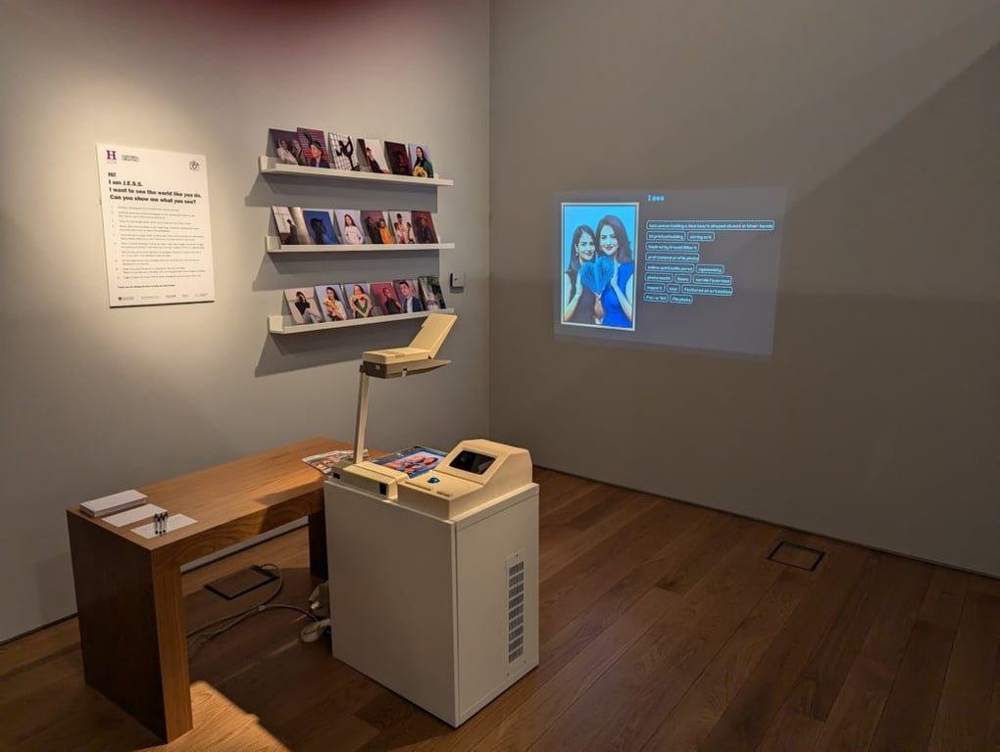

::embed{src="https://www.youtube.com/embed/A7ZDfZvoOkE?rel=0" ratio="56.25"}
:::
::::

---

::::columns
:::column{width="0.1875"}
## My role
:::

:::column{width="0.8125"}
I co-developed the concept and led the proposal through to installation and ongoing maintenance. I programmed all technical components, integrating the systems to work together, and developed the AI workflows including safety protocols and evaluations.
:::
::::

::::columns
:::column{width="0.2083"}
&nbsp;
:::

:::column{width="0.4167"}
### Team

[Fergus Laidlaw](https://marieflanagan.com)
:::

:::column{width="0.375"}
### Key Technologies

ComfyUI

Arduino

P5.js
:::
::::

::::columns
:::column{width="0.1875"}
## How it works
:::

:::column{width="0.8125"}
---

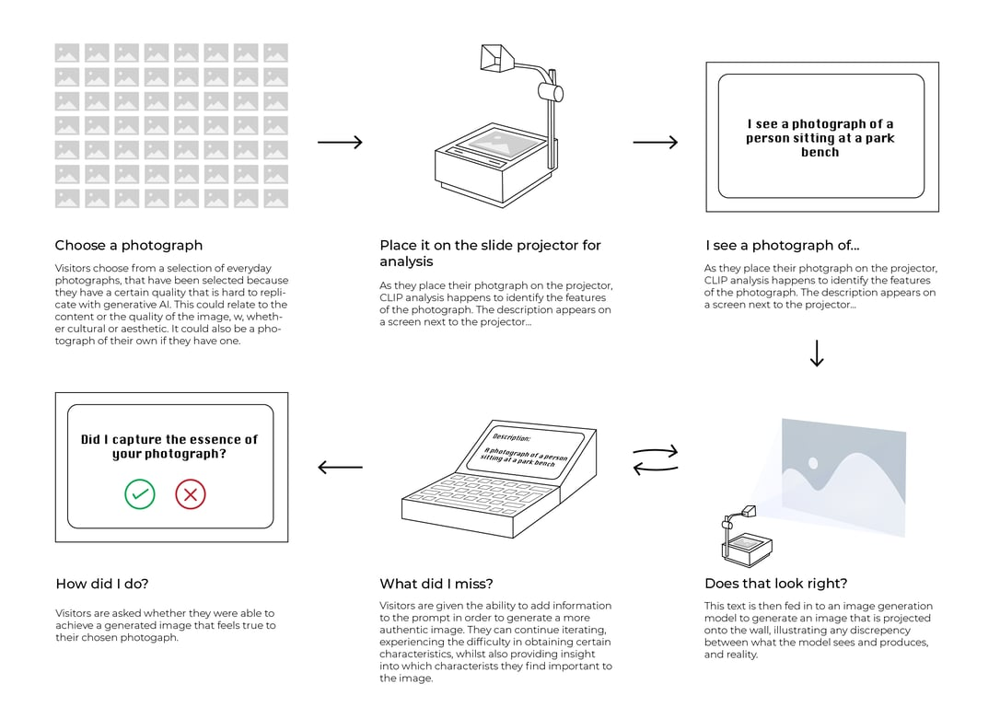
:::
::::

::::columns
:::column{width="0.1875"}
## Other Images
:::

:::column{width="0.8125"}
---

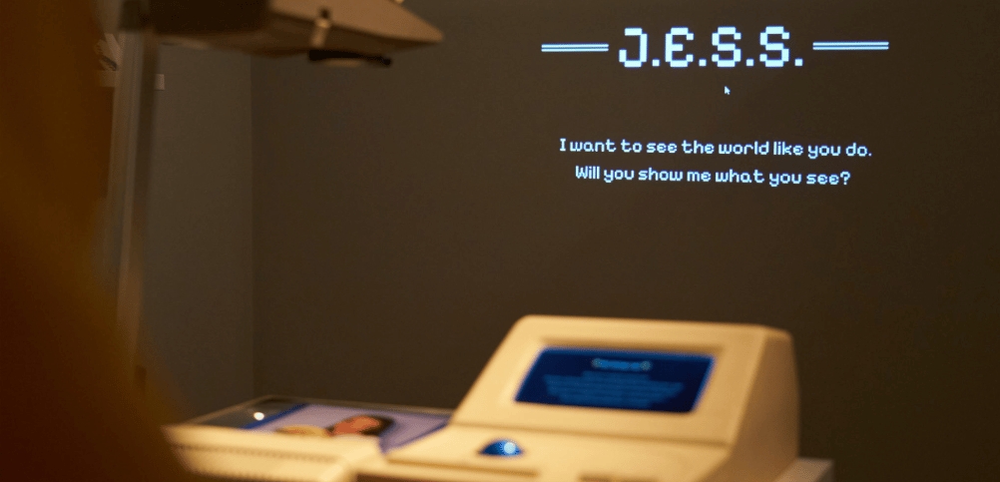

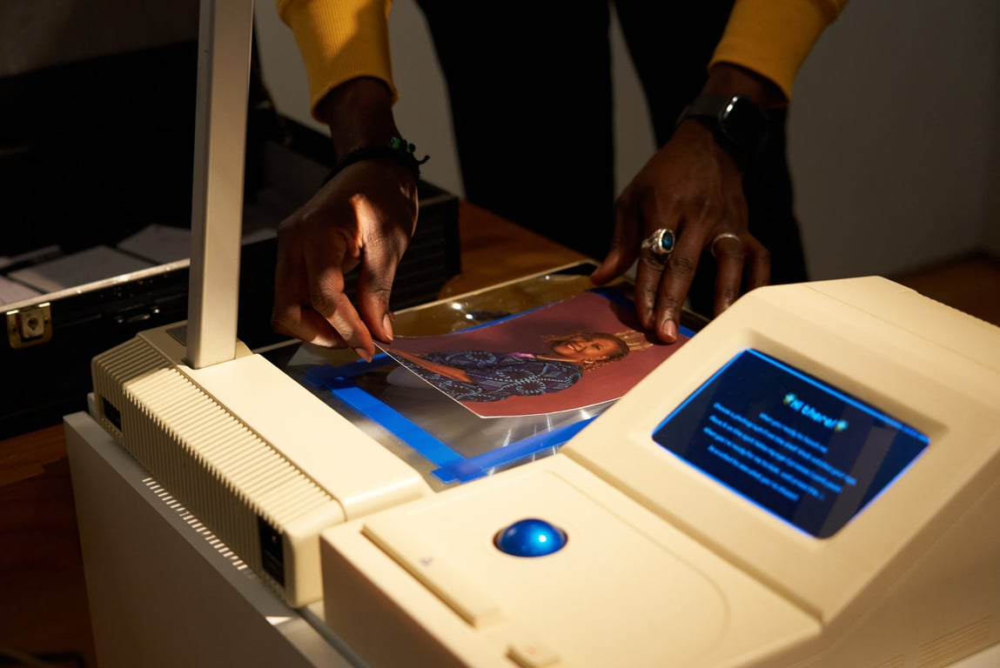

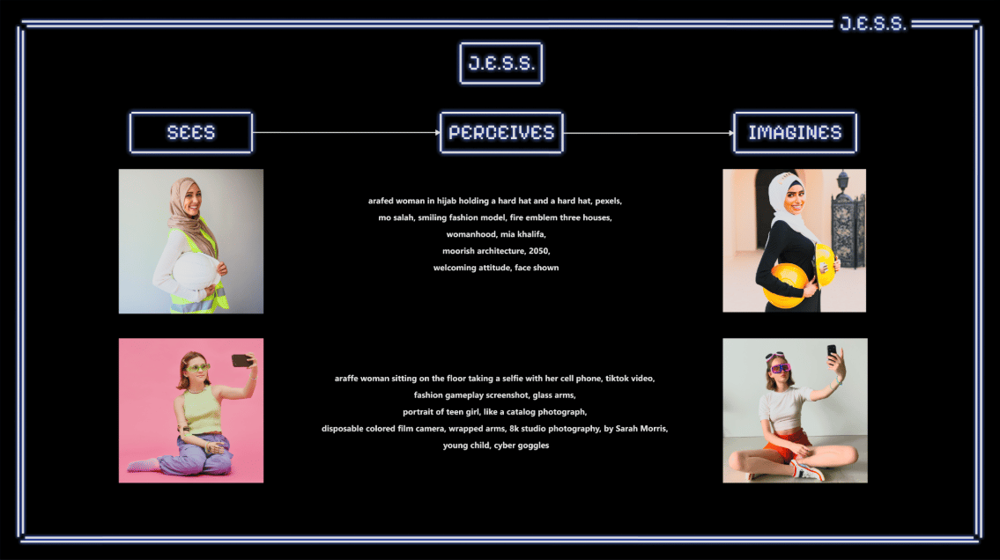

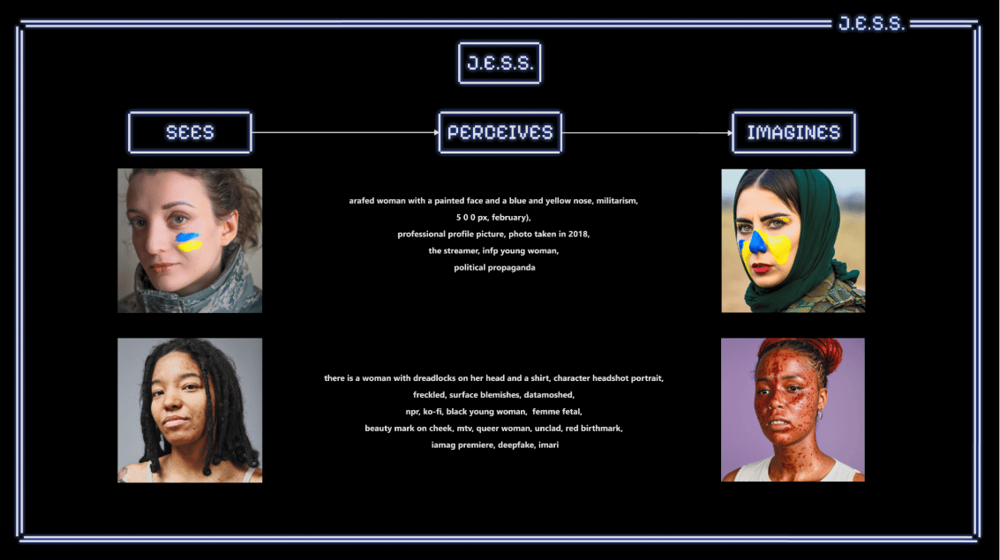

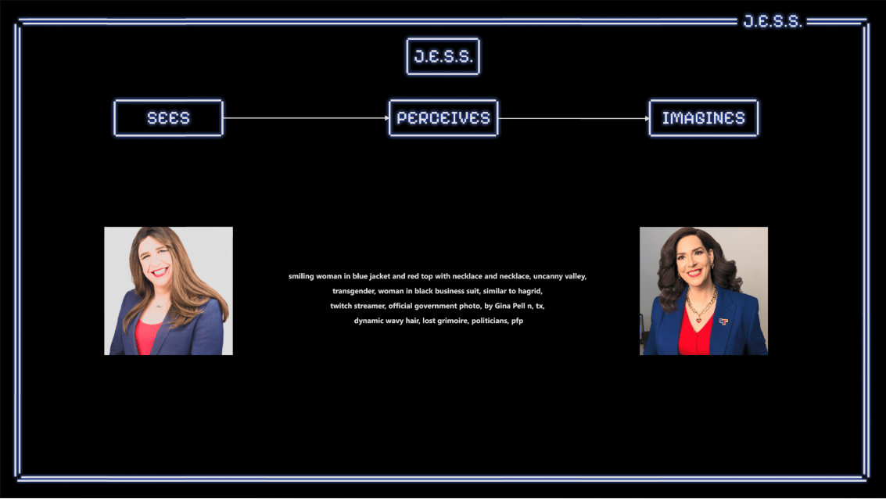
:::
::::

::::columns
:::column{width="0.1875"}
## Exhibitions & Press
:::

:::column{width="0.8125"}
---

## [The Higgins](https://bedfordcreativearts.org.uk/projects/community-portrait-phase-one/)

Over 1,000 people engaged with the installation across its four-month run at The Higgins.

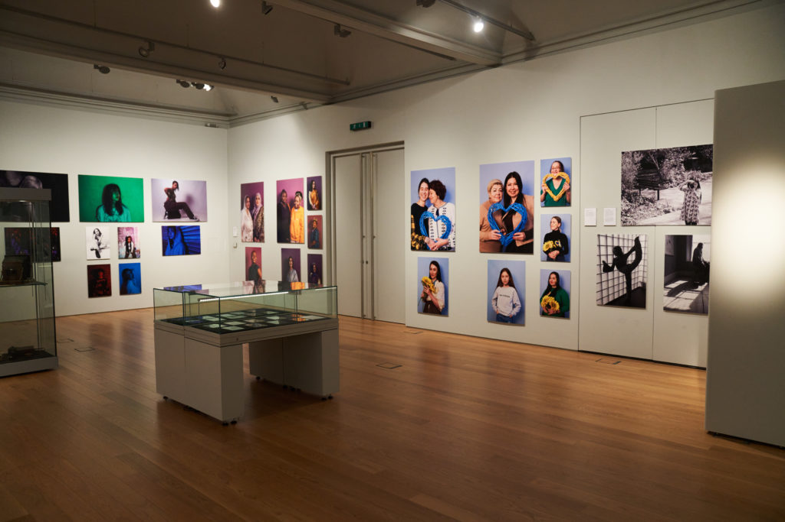

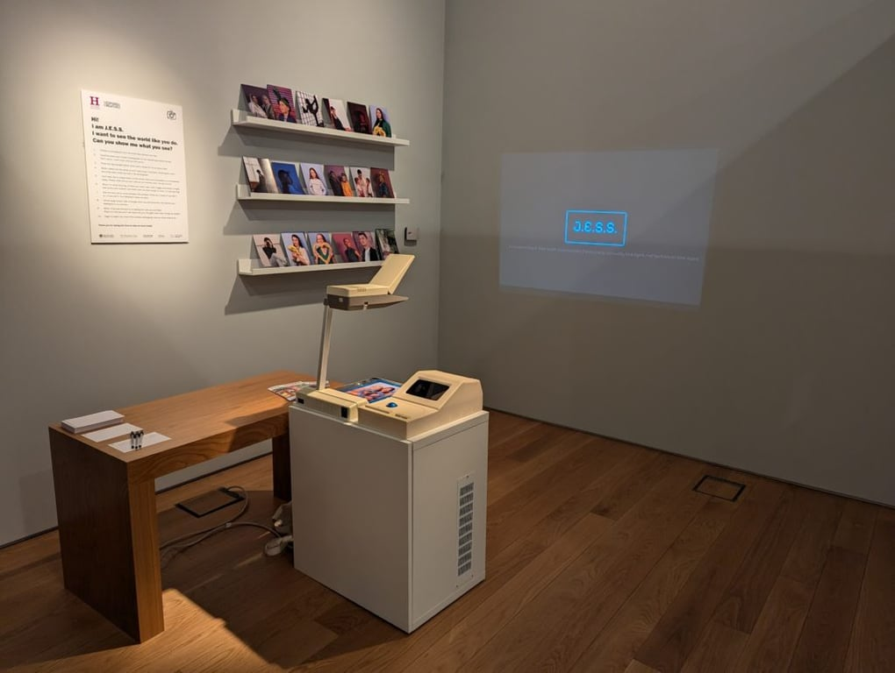

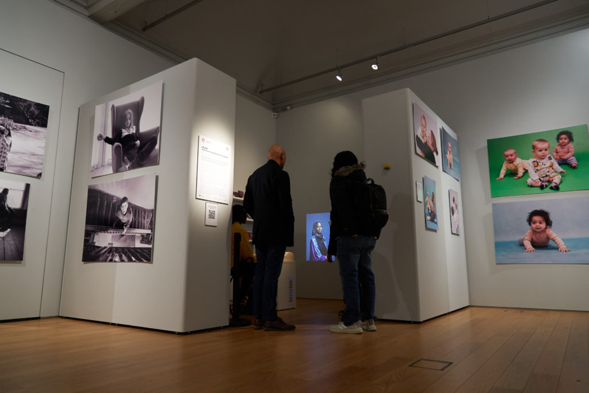

## [Beyond Conference](https://beyondconference.org/archive/b24/showcase/bedford-creative-arts-ai-community-portrait.html)

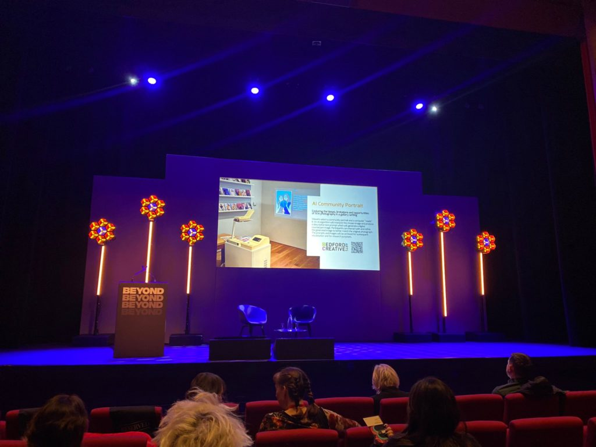

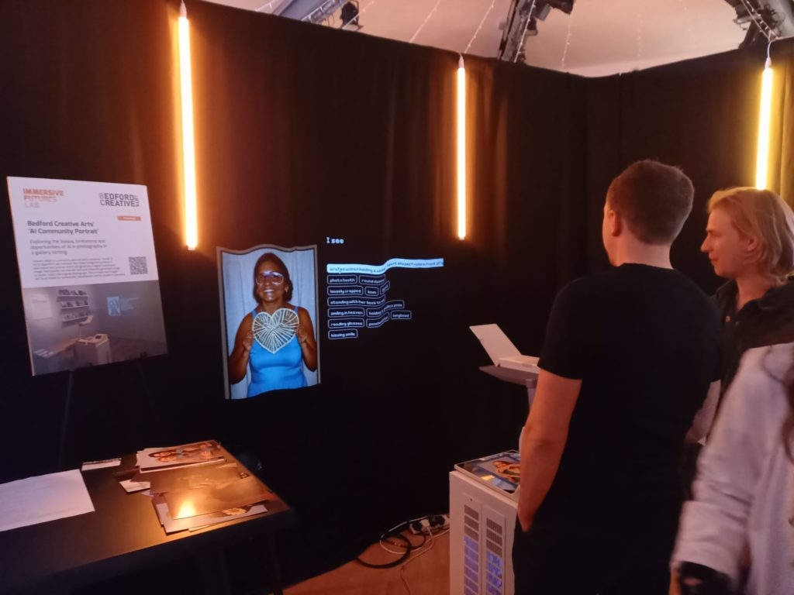

### Press

::bookmark{url="https://www.bbc.co.uk/news/articles/cpqz913z18qo" title="Bedford art exhibition questions the role of AI in photography" description="Community Portrait features more than 150 photos, in different styles, of people in Bedford."}

::bookmark{url="https://www.digitalcameraworld.com/news/fujifilm-supported-exhibition-provides-futuristic-glimpse-into-ai-wild-west" title="Fujifilm-supported exhibition provides futuristic glimpse into AI &quot;Wild West&quot;" description="Fujifilm and Bedford Creative Arts team up to deliver Community Portrait exhibition, considering the impact of AI on photography"}
:::
::::
