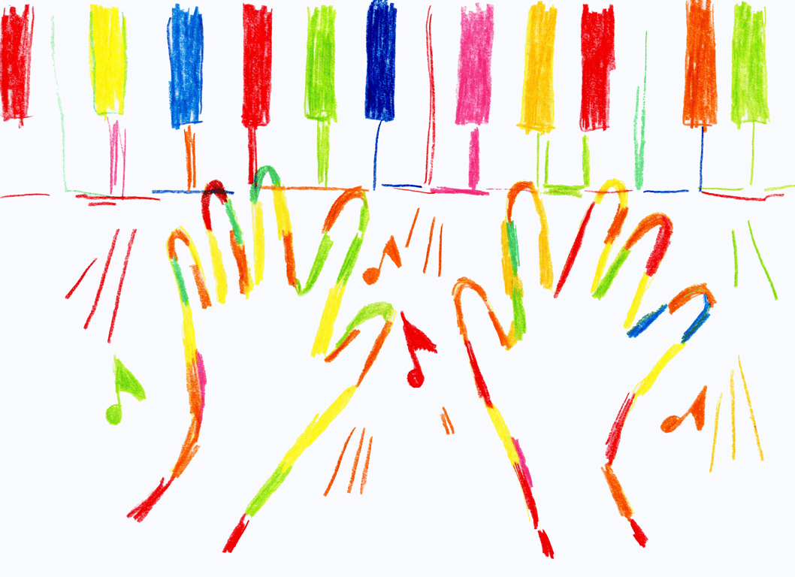
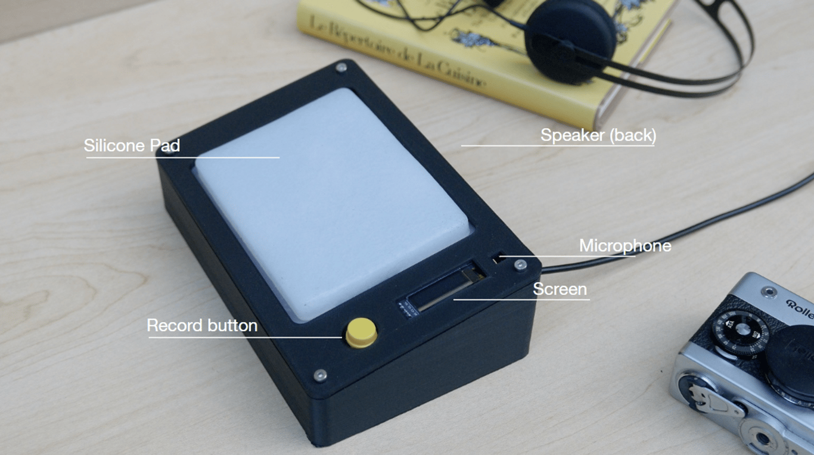
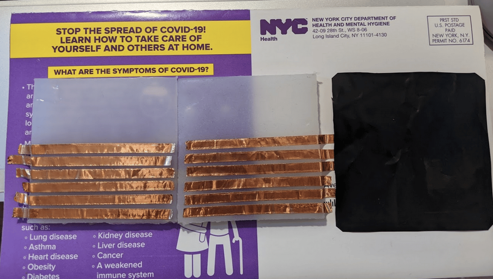
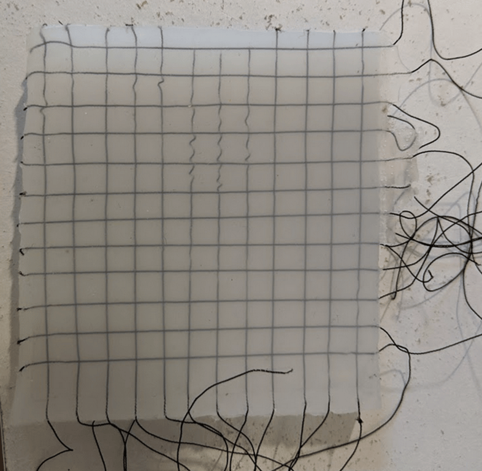
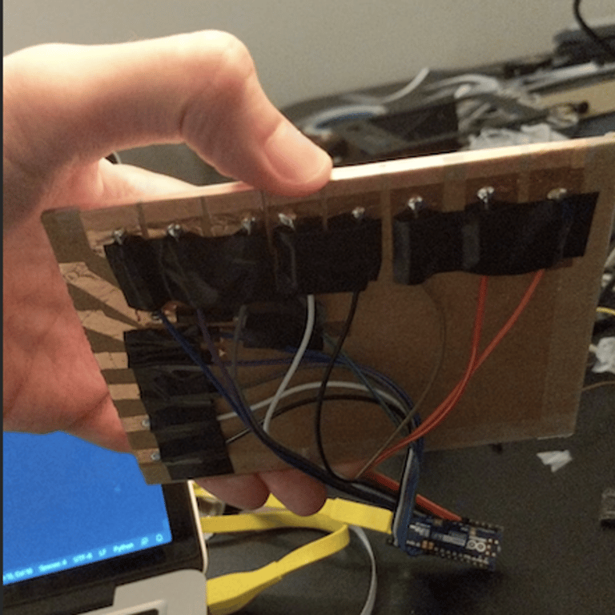
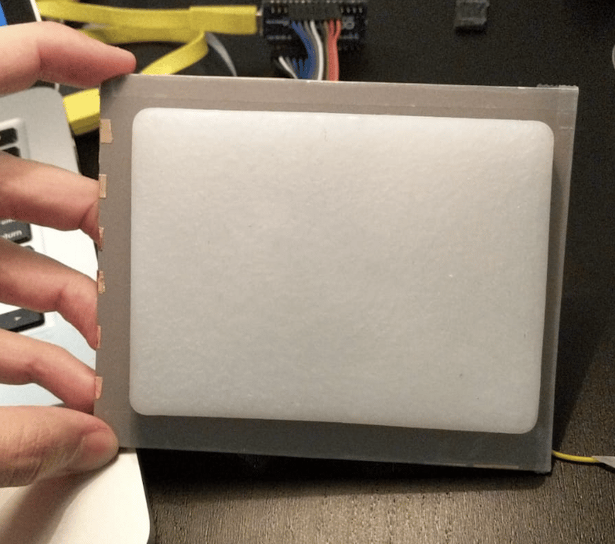
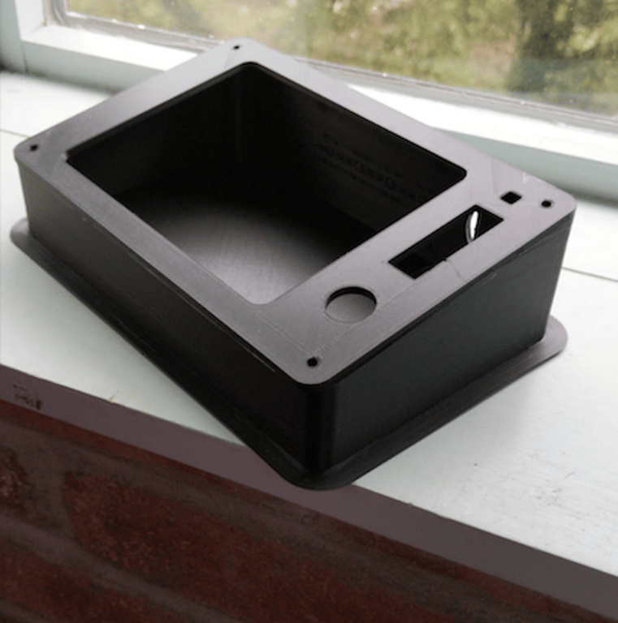
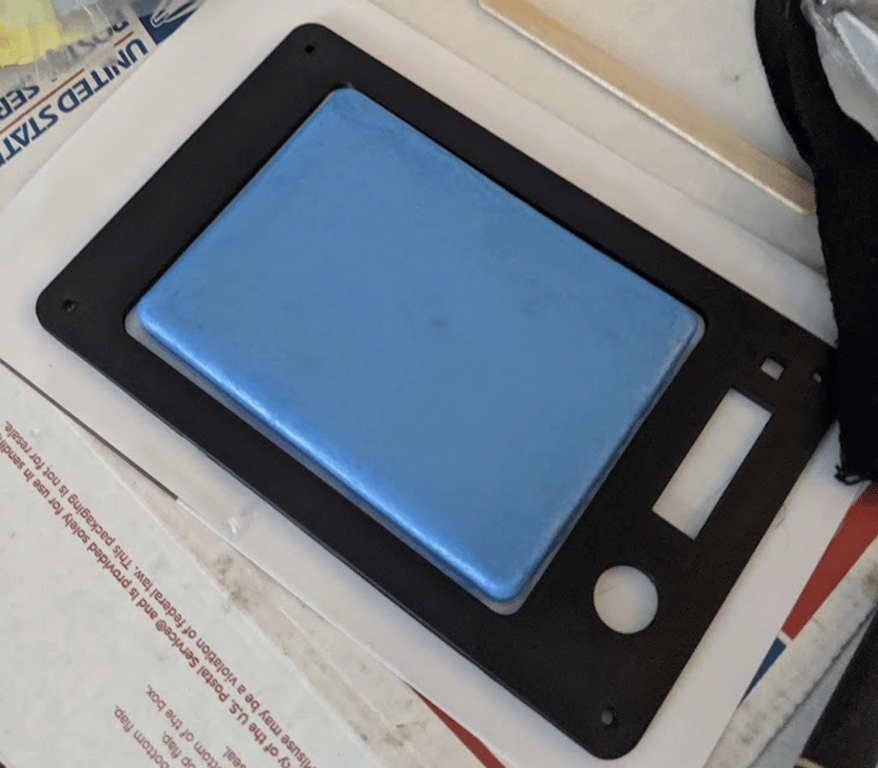
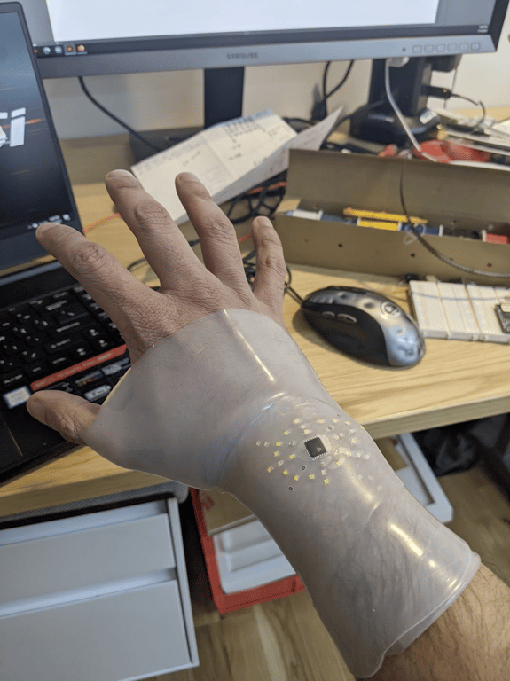
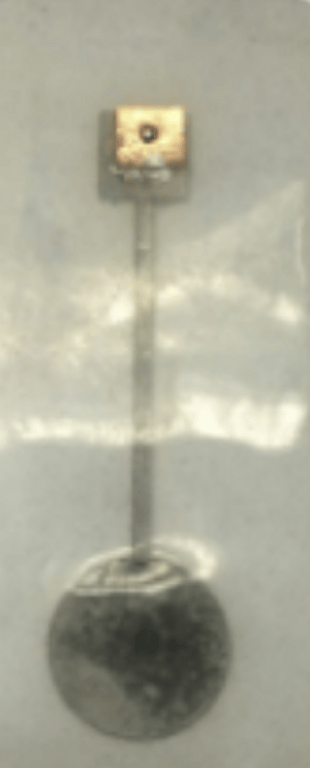

# MaDD: A soft-surface musical sampler

May - August 2020

::::columns
:::column{width="0.1875"}
## Overview
:::

:::column{width="0.8125"}
As a part of a fellowship with NYC Media Lab and American Society of Composers, Authors and Publishers (ASCAP), I was a part of a team that explored how emerging technologies can unlock new ways to create and experience music.

We tackled the limits of expressivity of current musical instruments by re-imagining the surface that is used to play music. Moving away from the current paradigm of switches, knobs, dials and other hard surfaces, we invented a new soft surface that was responsive, expressive, easy and joyful to use. The invention, MaDD is a portable soft-surface sampler that captures nuances in a user’s touch, allowing for increased expressiveness and customization of sound.

::embed{src="https://www.youtube.com/embed/D_fpMpt1Vfg?feature=oembed" ratio="56.20608899297424"}

---
:::
::::

::::columns
:::column{width="0.1875"}
## My role
:::

:::column{width="0.8125"}
I was responsible for designing, fabricating and interfacing the soft sensor that was at the heart of the music instrument.
:::
::::

::::columns
:::column{width="0.2083"}
&nbsp;
:::

:::column{width="0.4167"}
### Team

[Matthew Ross](http://mattross.live)

[Dana Elkis](https://danaelkis.com/)

[David Azar](https://www.davidazar.mx/)
:::

:::column{width="0.375"}
### Key Technologies

Raspberry Pi

Arduino

Python

PureData

Fusion360
:::
::::

::::columns
:::column{width="0.1875"}
## What it does
:::

:::column{width="0.8125"}
---

The sampler lets you record any snippet of sound.The music algorithm analyses the waveform for four peaks and cuts the audio into 4 pieces. These audio pieces are overlaid on the soft surface which can then be expressively manipulated with your fingers to create your own musical composition.

---
:::
::::

::::columns
:::column{width="0.1875"}
## Reception
:::

:::column{width="0.8125"}
The project was show-cased at NYC Media Lab Summit 2020. We had the honor of talking about discussing our project and its implication on the future of music with legend Vernon Reid of Living Colors.

::embed{src="https://www.youtube.com/embed/469Uoxscwfc?feature=oembed" ratio="56.20608899297424"}

The project was also covered by the following media outlets:

[Variety](https://variety.com/2020/digital/news/living-colour-vernon-reid-ascap-lab-1234794119/)

[PRS-Wire](https://www.prnewswire.com/news-releases/ascap-lab-seed-project-teams-explore-boundaries-of-music-creation-and-experience-two-finalists-to-present-at-new-york-city-media-lab-summit-on-oct-8-301146653.html)

[Music-Ally](https://musically.com/2020/10/07/ascap-lab-seed-project-reveals-first-projects-from-its-teams/)

---
:::
::::

::::columns
:::column{width="0.1875"}
## Build Images
:::

:::column{width="0.8125"}
We had applied for the fellowship with the idea before Covid was a reality. Hardware is hard and doing the project from our bedrooms without access to any maker-space equipment proved to be a very challenging process. I had the pleasure of working with a talented and passionate team that stayed flexible through the adversities and did not compromise on the original vision.

:::
::::

::::columns
:::column{width="0.25"}
&nbsp;
:::

:::column{width="0.375"}
::video{src="/media/creative-tech/madd/02e91258-3264-4686-af0a-4d9a5293c7e1.mp4"}
:::

:::column{width="0.375"}
::video{src="/media/creative-tech/madd/2eeb7d81-722a-497e-8139-9f39d862e143.mp4"}
:::
::::

---

::::columns
:::column{width="0.1875"}
## Future Work
:::

:::column{width="0.8125"}
This project is a part of my larger research into fabricating stretchable circuits and wearables using maker-space equipment. If this excites you or you have ideas, Please [get in touch](mailto:hey@chaky.works) and I would love to collaborate with you!
:::
::::

:::::columns
:::column{width="0.2083"}
&nbsp;
:::

:::column{width="0.2917"}
::video{src="/media/creative-tech/madd/e64f2283-de6b-44e1-afb9-282946733583.mp4" width="400"}

:::

::::column{width="0.5"}
::embed{src="https://www.youtube.com/embed/f8snBsJ_RjY?feature=oembed" ratio="56.20608899297424"}

:::figure{width="96"}

:::
::::
:::::
