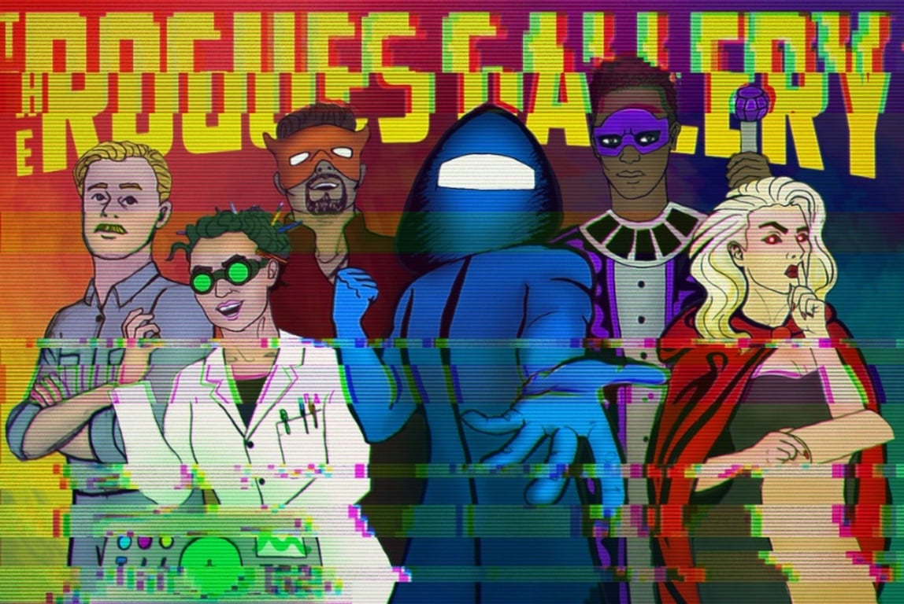
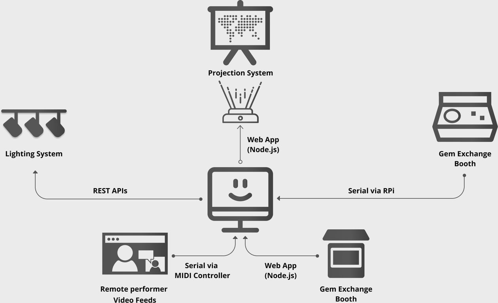
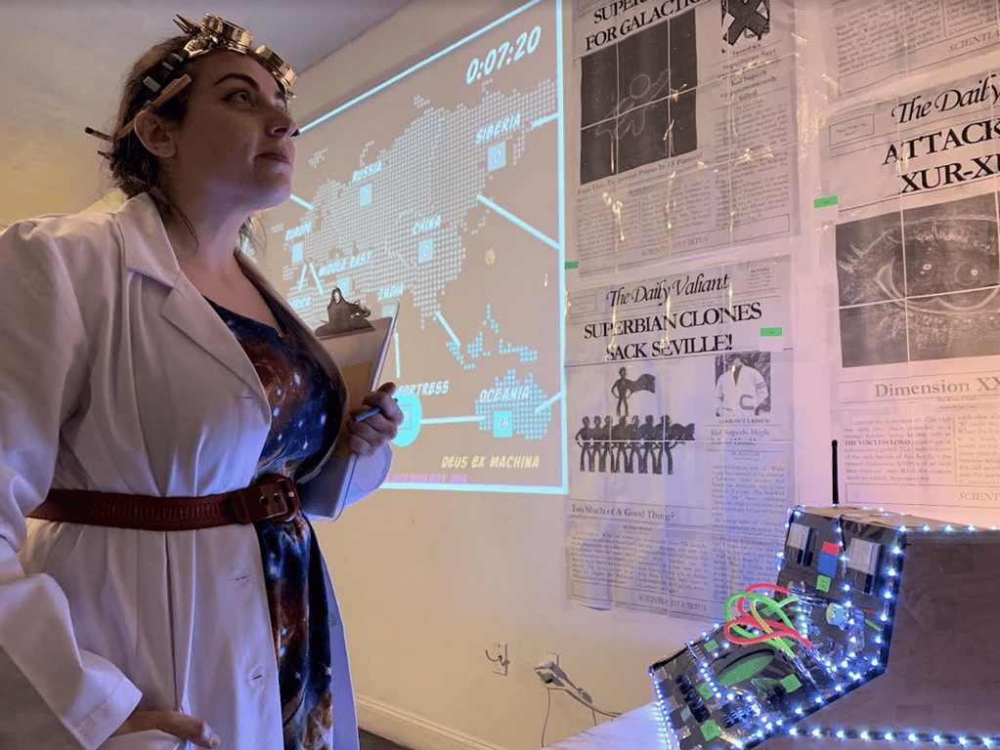
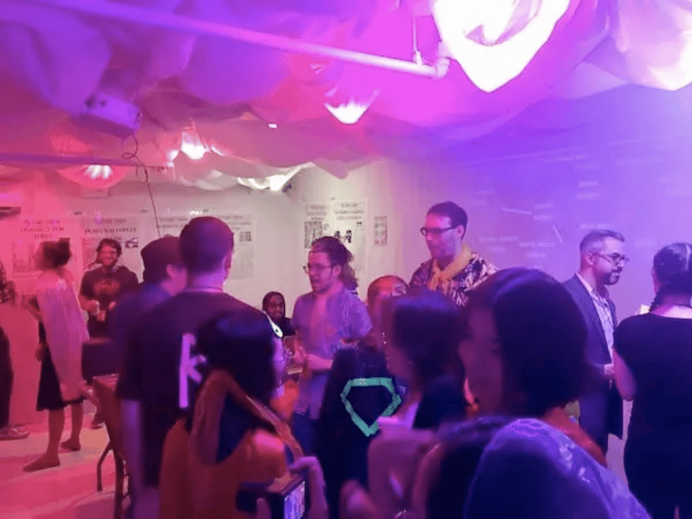
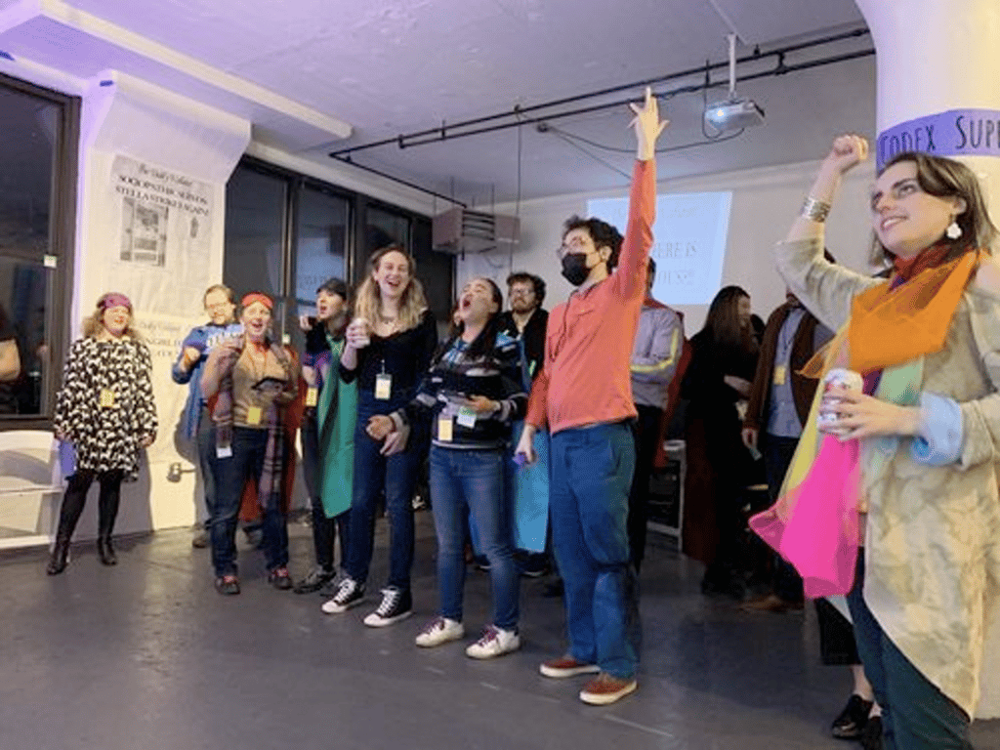
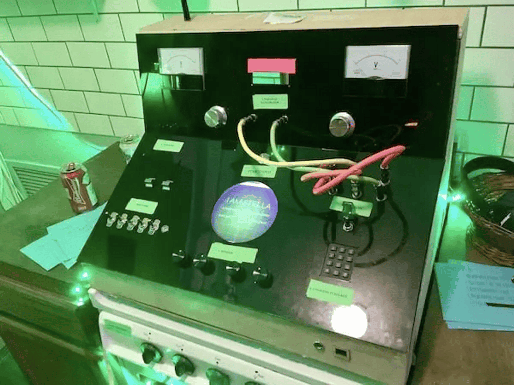

# Rogue’s Gallery

January - July 2019

::::columns
:::column{width="0.1875"}
## Overview
:::

:::column{width="0.8125"}
Combining roleplaying games, immersive theatre, and social deduction games, The Rogues Gallery is a megalomaniacal mega-game of world domination featuring a cast of maniacal d-list supervillains,. Build a doomsday device, team up with rivals and decipher occult mysteries to gain the upper hand over your heroic adversaries.

Unleash your inner villain in this fully immersive evening of world conquest and inevitable betrayal!

---
:::
::::

::::columns
:::column{width="0.1875"}
## My role
:::

:::column{width="0.8125"}
I was the technical director and creative technologist for the project that primarily included the design of the stage management back-end that would feed specific cues to the lighting system, digital/physical touch-points and video feeds based on user and performer actions. I also performed as a part of the immersive experience  and was one of the characters that participants could interact with during the live show.

---
:::
::::

::::columns
:::column{width="0.2083"}
&nbsp;
:::

:::column{width="0.4167"}
### Team

Broken Ghost Immersives

[Credits](https://www.brokenghostimmersives.com/the-rogues-gallery)
:::

:::column{width="0.375"}
### Key Technologies

Node.js, Raspberry pi, DMX.
:::
::::

::::columns
:::column{width="0.1875"}
## Critic Reviews
:::

:::column{width="0.8125"}
---

The show had multiple performances across Brooklyn/Manhattan and as a part of a residency at [Wildrence](https://www.brokenghostimmersives.com/the-rogues-gallery) in 2019.  All the show was sold-out and was very well-received by the critics.

[No Proscenium](https://noproscenium.com/take-over-the-world-in-the-rogues-gallery-a-nopro-adventure-3ae60860190c)

[ARG-Net](https://www.argn.com/2019/07/at-the-rogues-gallery-evil-its-own-currency/)

[Room Escape Artist](https://roomescapeartist.com/2019/08/28/broken-ghost-immersives-rogues-gallery-review/)
:::
::::

---

::::columns
:::column{width="0.1875"}
## Images
:::

:::column{width="0.8125"}

:::
::::
