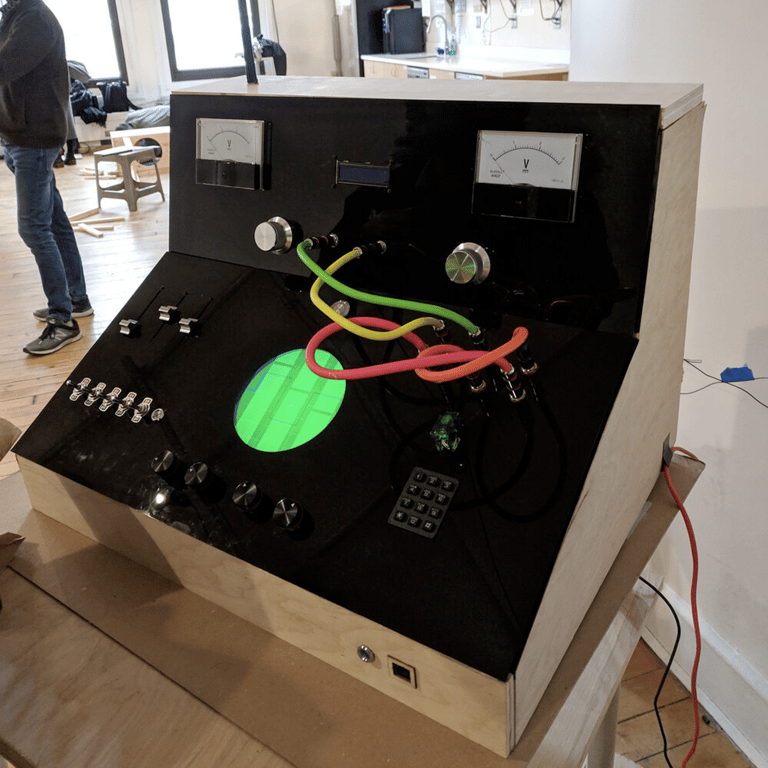
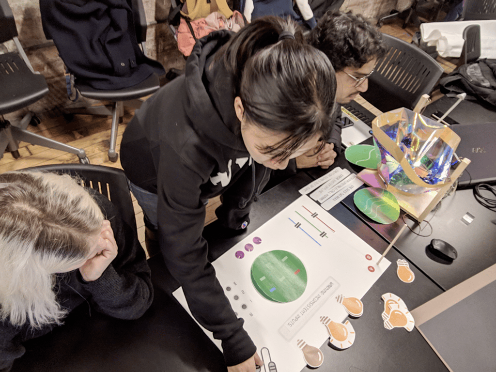
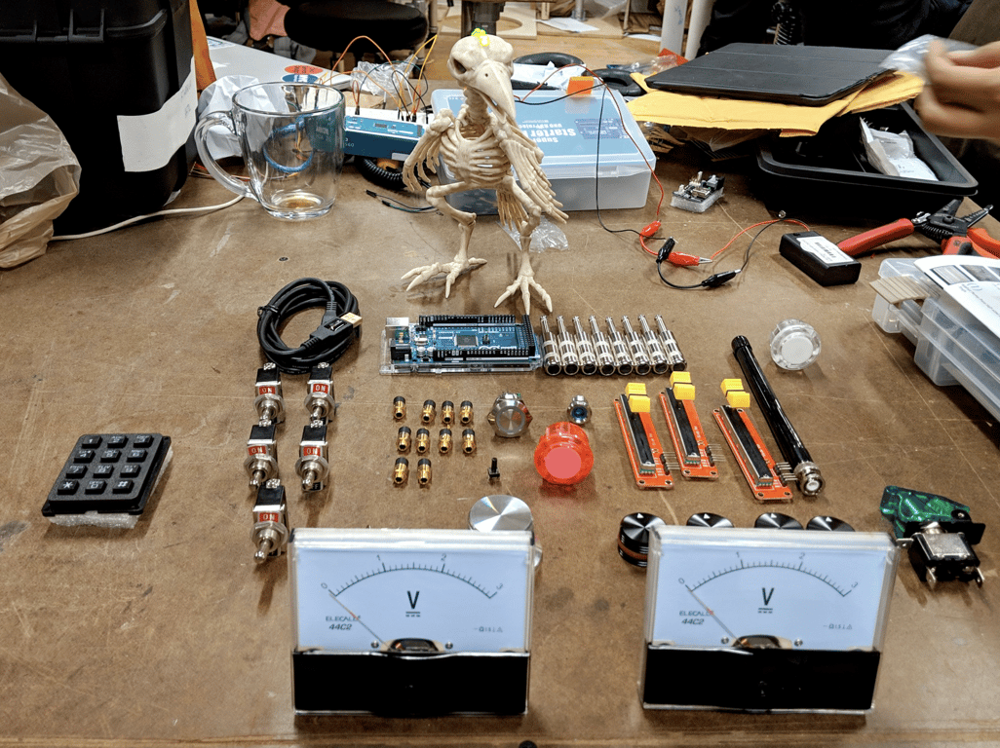
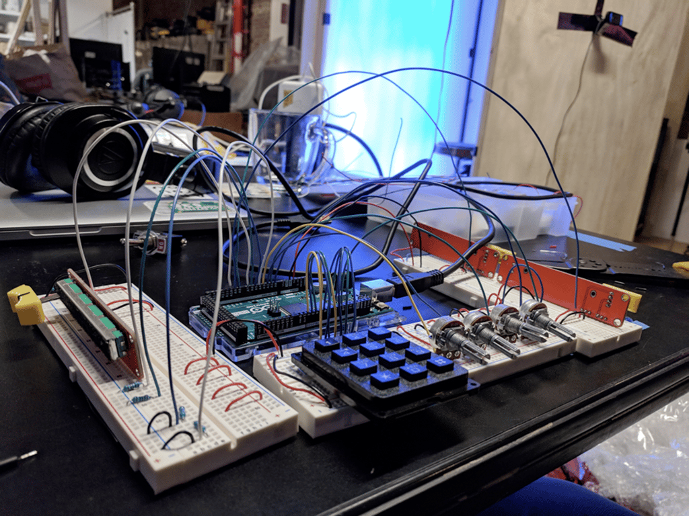
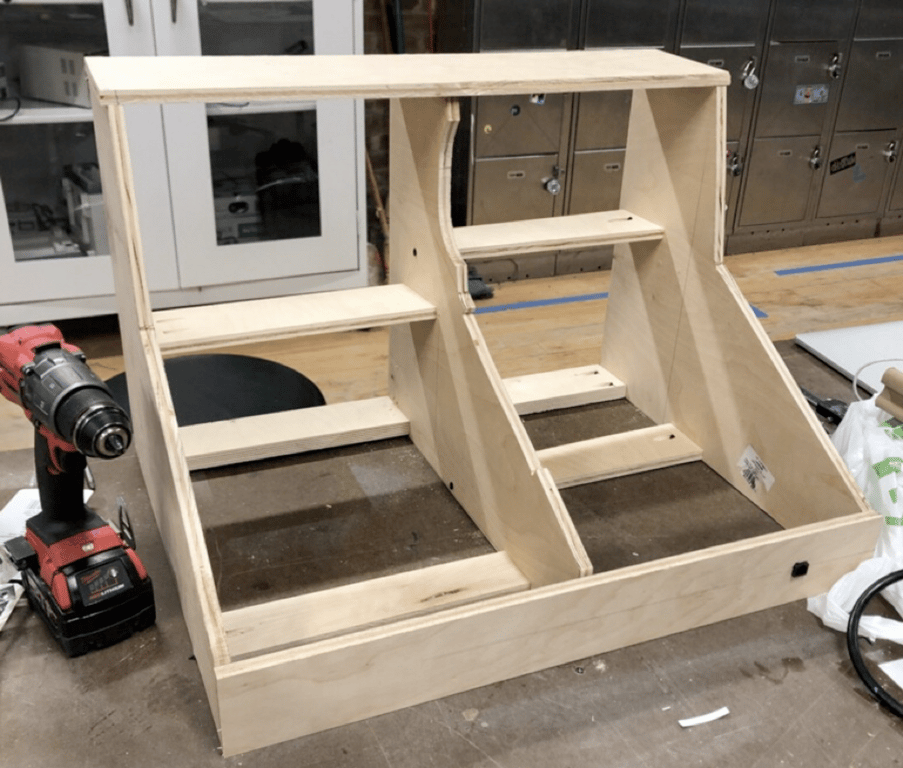
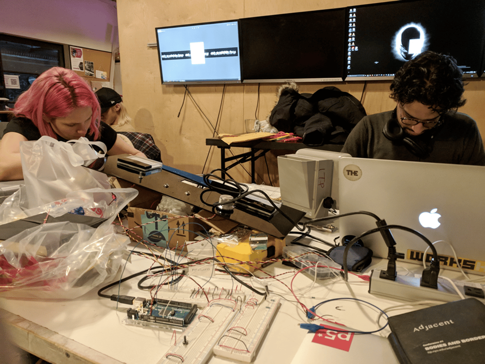
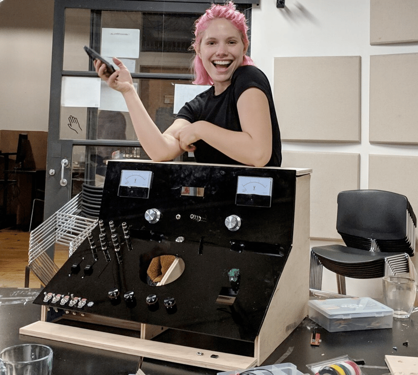

# The Box

September - December 2018

::::columns
:::column{width="0.1875"}
## Overview
:::

:::column{width="0.8125"}
A mysterious console, inspired by the hardware of our childhoods in the 90’s. Left along in a corner without any specific instructions, the box encourages you to twist, push, slide, plug and unplug to solve a series of increasingly difficult puzzles.

::loop{src="/media/creative-tech/the-box/giphy1.mp4" width="480" height="270"}

::loop{src="/media/creative-tech/the-box/giphy.mp4" width="480" height="270"}

---
:::
::::

::::columns
:::column{width="0.1875"}
## My role
:::

:::column{width="0.8125"}
I led the creative development, technical direction, game design, microcontroller programming of the project and contributed to fabrication and UI development.
:::
::::

::::columns
:::column{width="0.2083"}
&nbsp;
:::

:::column{width="0.4167"}
### Team

[Lillian Ritchie](https://www.linkedin.com/in/lillian-ritchie/)

[Atharva Patil](https://www.linkedin.com/in/atharvaabhaypatil/)
:::

:::column{width="0.375"}
### Key Technologies

Arduino

P5.js
:::
::::

::::columns
:::column{width="0.1875"}
## Exhibits
:::

:::column{width="0.8125"}
---

The Box was shown at the NYU ITP Winter show 2018 and then had a second life as an interactive character in an [immersive experience](/creative-tech/rogues-gallery).

::embed{src="https://www.youtube.com/embed/02z_yyHAm-U?start=681&feature=oembed&start=681" ratio="56.20608899297424"}
:::
::::

::::columns
:::column{width="0.1875"}
## Build Images
:::

:::column{width="0.8125"}
---

::loop{src="/media/creative-tech/the-box/giphy6.mp4" width="478" height="300"}

::loop{src="/media/creative-tech/the-box/giphy2.mp4" width="480" height="270"}

::loop{src="/media/creative-tech/the-box/giphy4.mp4" width="480" height="270"}

::loop{src="/media/creative-tech/the-box/giphy5.mp4" width="480" height="478"}

:::
::::
