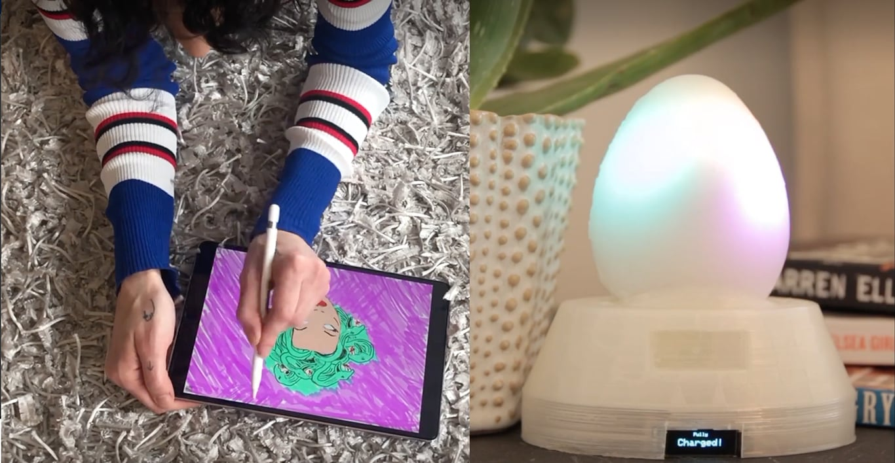
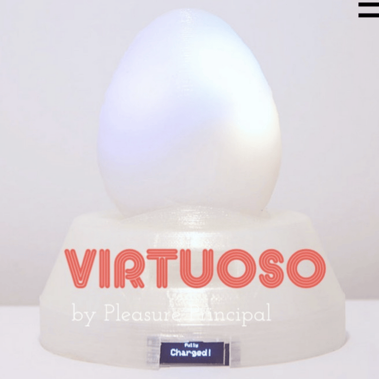
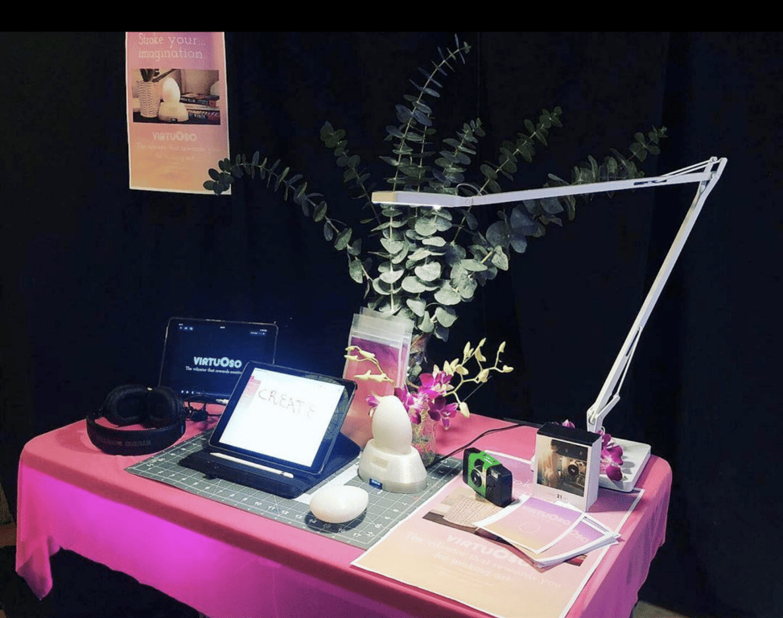

# VirtuOso

January - May 2019

::::columns
:::column{width="0.1875"}
## Overview
:::

:::column{width="0.8125"}
VirtuOso connects to a drawing app that charges your vibrator while you make art. The longer you doodle, draw, or write using the app, the longer you can use your virtuOso vibe! You can also set your virtuOso to 'live mode' for instant positive reinforcement as you make art ;)

With virtuOso, you align the body's built-in reward system with making art. By autonomously—and autonomically— triggering reward for creativity, it becomes more tangible, achievable, and frequent. More practice, more pleasure!

---
:::
::::

::::columns
:::column{width="0.1875"}
## My role
:::

:::column{width="0.8125"}
This project was a collaboration with Gabriella Garcia who let the idea development, video, design. I was the creative technologist on the project and was responsible for the creative development, technical direction, fabrication and programming of the vibrator.
:::
::::

::::columns
:::column{width="0.2083"}
&nbsp;
:::

:::column{width="0.4167"}
### Team

[Gabriella Garcia](https://higabriella.com/)
:::

:::column{width="0.375"}
### Key Technologies

Arduino

Javascript, HTML, CSS.
:::
::::

::::columns
:::column{width="0.1875"}
## How it works
:::

:::column{width="0.8125"}
---

In its current iteration, the device has 2 modes:

- 
- 

::video{src="/media/creative-tech/virtuoso/b1dcbe14-5ab0-45c5-ae5b-5cb1ccfef657.mp4"}

[Full demo video](https://www.pleasureprincipal.me/)

[Project Documentation](https://www.pleasureprincipal.me/about)

---
:::
::::

::::columns
:::column{width="0.1875"}
## Exhibits
:::

:::column{width="0.8125"}
Virtuoso was show-cased at the NYU ITP Spring show 2019.

:::
::::
