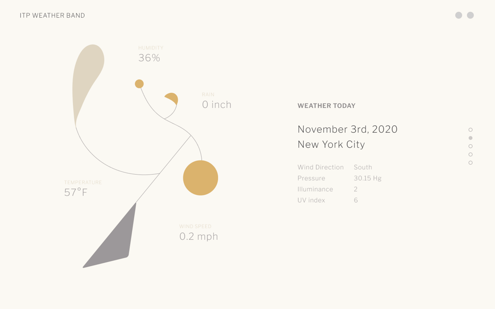
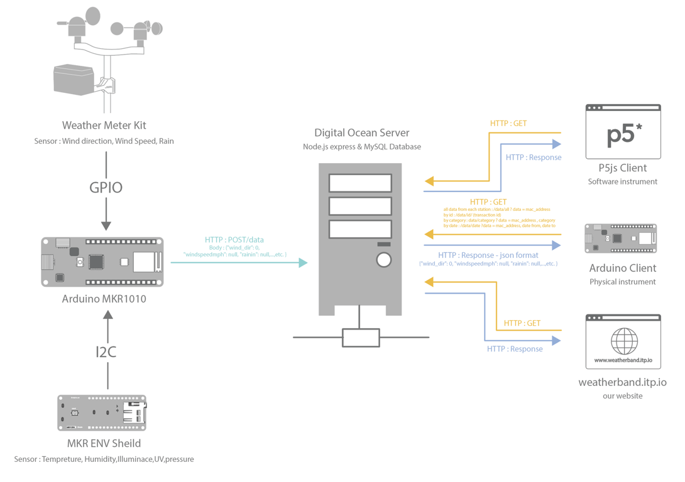

# ITP Weather Band

August 2019 - July 2020

::::columns
:::column{width="0.1875"}
## Overview
:::

:::column{width="0.8125"}
ITP Weather Band is an experimental band creating music and visuals with weather data collected from a DIY weather station. We built a weather station system and created experimental instruments that turn the environmental data into music and visuals.

::embed{src="https://www.youtube.com/embed/quKF_MFkj9o?feature=oembed" ratio="56.20608899297424"}

---
:::
::::

::::columns
:::column{width="0.1875"}
## My role
:::

:::column{width="0.8125"}
I was responsible for the weather station design, making the weather station Arduino talk to the database and wrote the template code for various physical/software clients to fetch data from the server.

:::
::::

::::columns
:::column{width="0.2083"}
&nbsp;
:::

:::column{width="0.4167"}
### Team

[Team credits](https://github.com/ITPNYU/weather-band)

Visual Design: [Yichan Wang](https://yichanwang.me)
:::

:::column{width="0.375"}
### Key Technologies

Arduino

P5.js
:::
::::

::::columns
:::column{width="0.1875"}
## Artifacts
:::

:::column{width="0.8125"}
---

The ITP Weather Band was used my many students to create projects that explore new ways of delivering information and stories about our immediate environment through auditory and visual senses. Collaboratively, we were invited to perform live at the [Network Music Festival](https://networkmusicfestival.org/programme/performances/itp-weather-band-first-day-of-summer/) in July 2020 and ITP Spring show 2020.

::embed{src="https://w.soundcloud.com/player/?visual=true&url=https%3A%2F%2Fapi.soundcloud.com%2Fplaylists%2F1094227333&show_artwork=true" height="450" width="500"}

::embed{src="https://www.youtube.com/embed/AF5m9Z7KnwY?list=PLivoY25uYfN-sgotkwOBMYgf_n7po0Bn9" ratio="56.20608899297424"}

::embed{src="https://www.youtube.com/embed/WQlXxjl6_Fs?list=PLivoY25uYfN_zJ3dkhvGiS7i4OoCJO5qt" ratio="56.20608899297424"}
:::
::::
