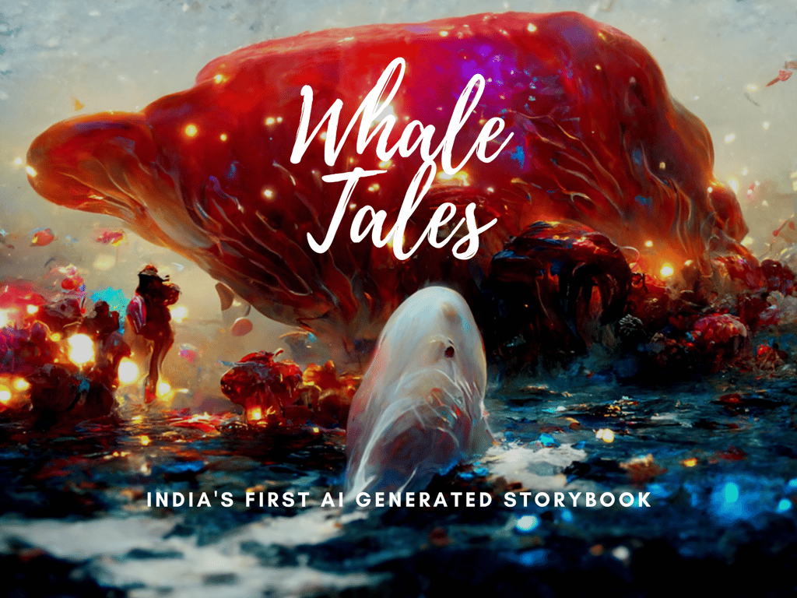
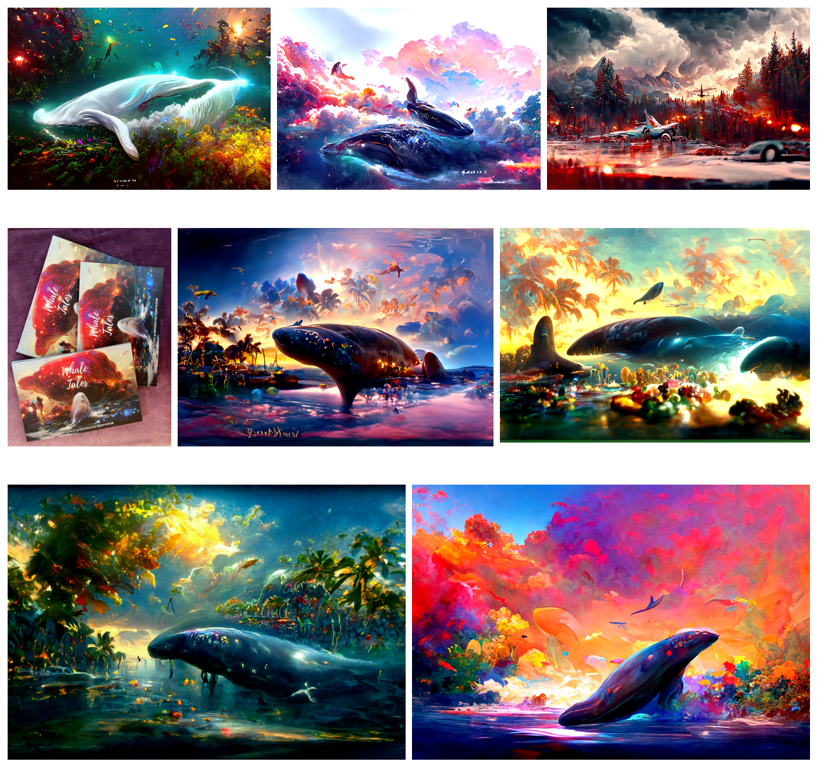
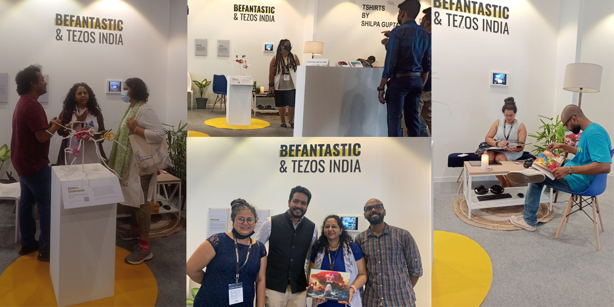
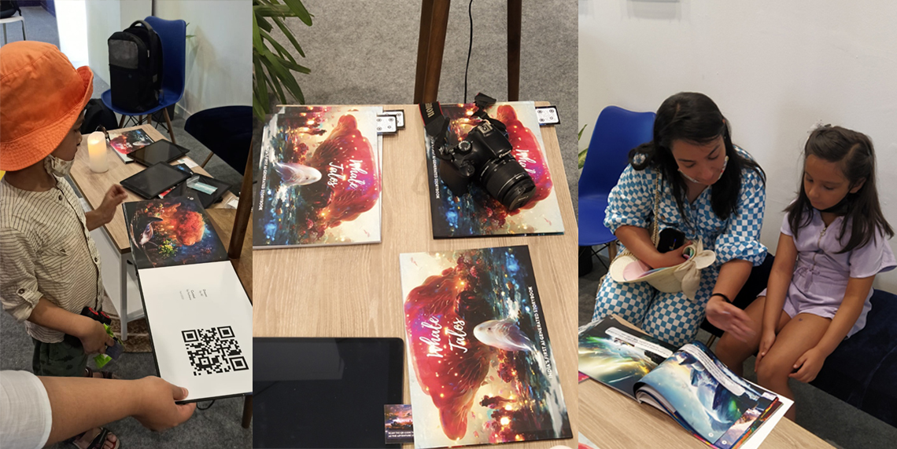
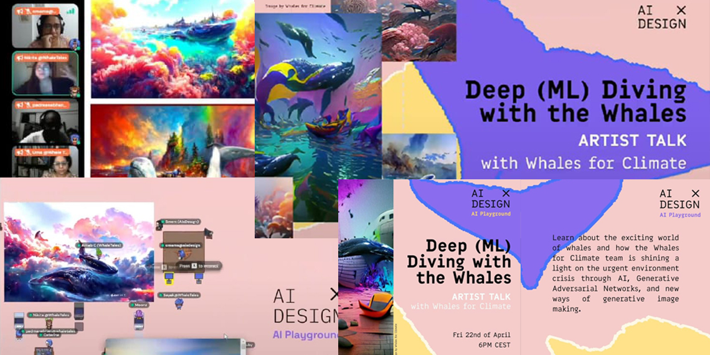
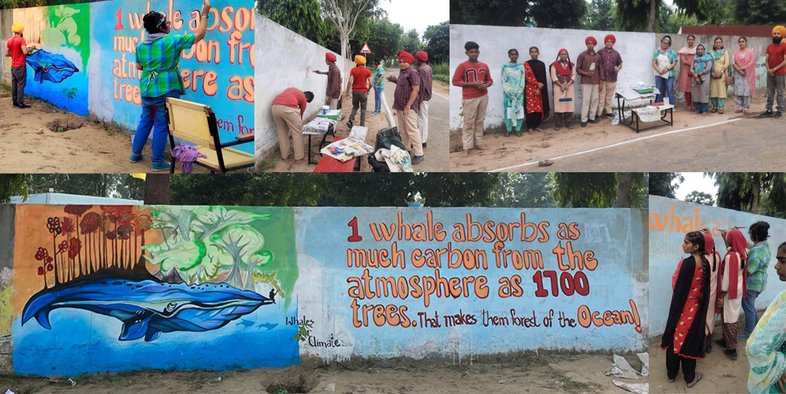

# Whale Tales

September 2021 - May 2022

::::columns
:::column{width="0.1875"}
## About
:::

:::column{width="0.8125"}
Whale Tales was a first-of-its-kind art project using emerging AI diffusion models to explore the aesthetics of the medium while constructing a hopeful narrative around climate change. Commissioned as part of an art fellowship by BeFantastic, the project began with exploring these models, understanding their limitations and developing a workflow where both text and images were AI-generated and curated by the artists. The final book was exhibited at art festivals across India, covered by major national publications, and used to develop new educational approaches for design students and traditional artists.

---
:::
::::

::::columns
:::column{width="0.1875"}
## My role
:::

:::column{width="0.8125"}
I set up the Google Colab infrastructure, refined workflow parameters, and developed the prompt engineering approach to achieve our art direction. This allowed the team to generate images without needing to engage with the code underneath.
:::
::::

::::columns
:::column{width="0.2083"}
&nbsp;
:::

:::column{width="0.4167"}
### Team

[BeFantastic Fellows](https://befantastic.in/together/whale-tales/)
:::

:::column{width="0.375"}
### Key Technologies

Disco Diffusion

VQ-GAN + CLIP

GPT-3
:::
::::

::embed{src="https://drive.google.com/file/d/1DjPP1biaBEnsWMPYLWRW243ywXL1UCkT/preview?usp=embed_googleplus" height="320"}

---

::::columns
:::column{width="0.1875"}
## Exhibits & Press
:::

:::column{width="0.8125"}
### The book was exhibited at:

[India Art Fair](https://befantastic.in/indiaartfair/)

[Bangalore Literature Festival](https://bangaloreliteraturefestival.org/session/whale-tales/)

BeFantastic Showcase, Samsung Opera House, Bengaluru, India

C3 Open House, Harkat Studios, Mumbai, India

### The project received press coverage including:

[Live Mint - When it comes to tech-art, who is the real creator?](https://lifestyle.livemint.com/smart-living/innovation/when-it-comes-to-tech-art-who-is-the-real-creator-111651298897087.html)

[The Vogue - India Art Fair 2022: 8 shows and installations to look out for](https://www.vogue.in/culture-and-living/content/india-art-fair-2022-shows-installations-to-look-out-for)

[India Art Fair - India Art Fair: Tezos India brings Clean NFT Art to the Masses](https://www.tzapac.com/articles/india-art-fair-tezos-india-brings-clean-nft-art-to-the-masses/)

[Thoughtworks Asia - Climate change showcase](https://thoughtworksarts.io/blog/climate-action-showcase-artahack-befantastic/)

[The Indian Express - With interactive, utilitarian art and ‘easy access’, creators aim to ease anxieties around NFTs at India Art Fair](https://indianexpress.com/article/lifestyle/art-and-culture/interactive-utilitarian-art-easy-access-creators-aim-to-ease-anxieties-around-nfts-india-art-fair-7898892/)

[The Indian Express - A unique AI project wants to make youngsters aware of the plight of whales and why they need to be conserved](https://indianexpress.com/article/express-sunday-eye/unique-ai-project-youngsters-aware-plight-of-whales-conservation-7961242/)

[First Post - Why digital art and NFT stood out at the India Art Fair](https://www.firstpost.com/art-and-culture/why-digital-art-and-nft-stood-out-at-the-india-art-fair-10642241.html)

[New Indian Express - Shaking things up through art](https://www.newindianexpress.com/cities/delhi/2022/apr/29/shaking-things-up-throughart-2447799.html)

The book was also acquired by several institutional libraries, including the National School of Drama, MMB Kolkata, British Council Delhi, and St. Xavier's College Kolkata.

::video{src="/media/creative-tech/whale-tales/whatsapp-video-2026-01-02-at-20-57-58.mp4" width="708"}

---
:::
::::

::::columns
:::column{width="0.1875"}
## Education Outreach
:::

:::column{width="0.8125"}
Beyond exhibitions, the project served as a starting point for educational initiatives demystifying this emerging medium for artists and students.

### AIxDesign Presentation

An online talk attended by artists worldwide exploring the workflows and creative possibilities of the medium.

[Link](https://aixdesign.co/posts/ai-moving-image)

Resources

### Rural School Workshop, North India

A hands-on workshop with non-English speaking students from a rural school. Using Google Transliteration, students converted ideas from their mother tongue into prompts for Disco Diffusion, creating moodboards that inspired a mural they painted on a highway wall, guided by a local mural artist.

### Winter School Module, Anant University

Students explored native Indian art forms alongside local artists, using AI tools to reimagine traditional work and examine both the promise and limitations of these tools.

Curriculum Outline:

::embed{src="https://drive.google.com/file/d/1rXpMDh6OufdgzbdGivjzz4tI_Z9U3xe-/preview?usp=embed_googleplus" height="320" width="400"}
:::
::::
