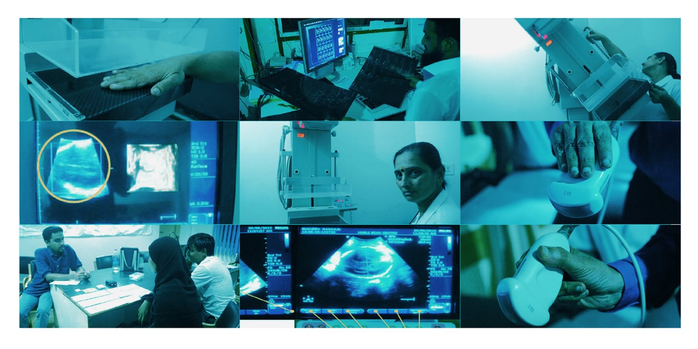
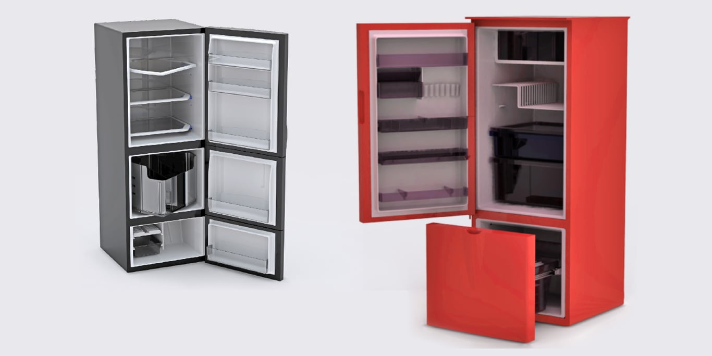
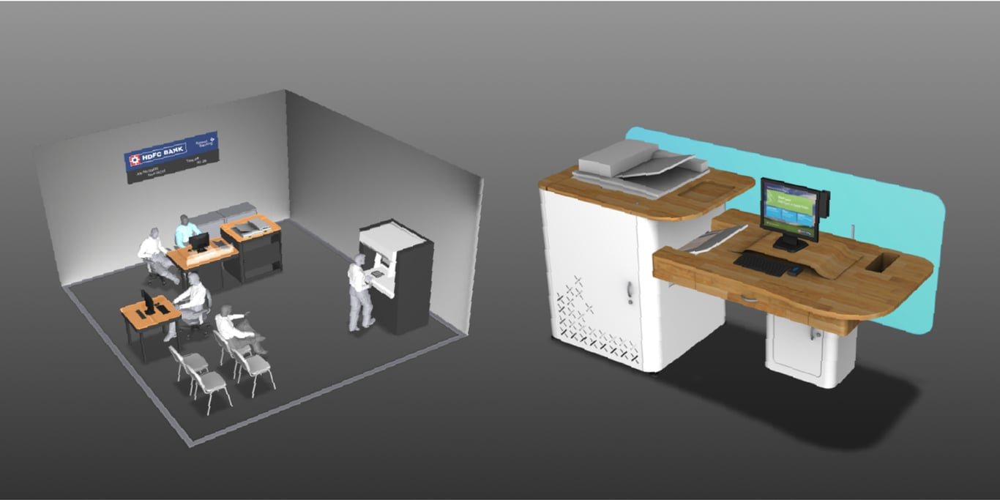

# Design Research

May 2012 - May 2014

::::columns
:::column{width="0.1875"}
## Overview
:::

:::column{width="0.8125"}
As a User Researcher, I worked on multiple consultancy projects for clients such as Siemens, Xerox, Samsung amongst others to discover/validate contextually innovative digital experiences and services in India through generative research, concept prototyping, user validation.

---
:::
::::

::::columns
:::column{width="0.1875"}
## Projects
:::

:::column{width="0.8125"}

<u>Client</u>: Siemens Healthcare

<u>Methods</u>: Ethnographic research, contextual interviews, card sorting.

The brief of this project was to understand the landscape of use of ultrasound devices in smaller towns of India. The market consists of independent healthcare facilities that are sole-proprietorship and have different needs compared to large hospitals in cities. The Siemens team wanted to find opportunities to better serve them and increase their market share. The project team spent time shadowing medical doctors, interviewing hospital administrators, observing and interacting with medical support staff.

The insights from the field research were used to generate opportunity areas in collaboration with the Siemens team. The findings were presented to the senior management team and the findings were shared in form of slides presentations for internal pitch, a physical book and key concept cards that were distributed amongst key stakeholders.

<u>Client</u>: Samsung, Korea

<u>Methods</u>: Ethnographic research, contextual interviews, card sorting, body-storming, concept development, semiotic analysis, prototyping.

The brief of this project was to come up with concept refrigerators that addressed the unique needs of middle-class Indian families. Extensive user studies were conducted across six cities through interviews, cart sorting and field visits.

The data was then synthesized and shared amongst the team to create a comprehensive understanding of how Indian families use refrigerators. Ideation workshops and brainstorming sessions were conducted to generate a huge volume of ideas which were then condensed into 6 concept refrigerators. These refrigerators were then presented to the Samsung Korea design team along with the design research findings.

<u>Client</u>: Xerox Research, Bangalore

<u>Methods</u>: Ethnographic research, body-storming, concept development, semiotic analysis, prototyping.

Engineers at Xerox Research Center India integrated OCR (optical character recognition) technology and digital interface within the Xerox machines. With these simple yet ingenious capabilities, they envisioned to revolutionize paper-handling processes in industries like banking. Their technology had the potential to reduce the paperwork, turn-around time and human error in banking processes encouraging more people to have a bank account. In the six months project, the team helped define the scope and the problem all the way to piloting with the prototype and internal pitch. The team delivered a complete end to end design solution that incorporated the physical space, user flows, digital interfaces and key user interactions.
:::
::::
