# Dubai Heart-safe City

August 2017 - May 2018

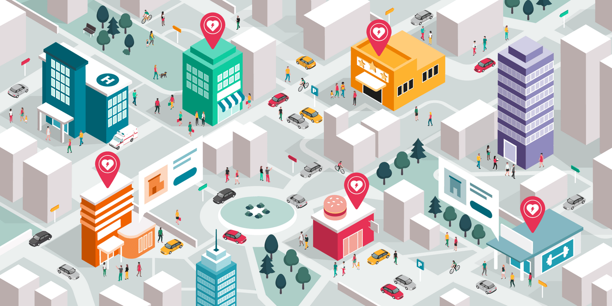

::::columns
:::column{width="0.1875"}
## Overview
:::

:::column{width="0.8125"}
Globally, the survival rate for sudden out-of-hospital cardiac arrests is 5-10%. The ‘Dubai Heart-safe City’ program was envisioned to make Dubai the world's heart-safest city by reducing the response rate to a sudden cardiac arrests. The intended goal of bringing the survival rate outside of the hospital from the current 5 to 65% would place Dubai amongst the top 3 safest cities in the world.

::embed{src="https://www.youtube.com/embed/vOtiHPQmQRw?feature=oembed" ratio="56.20608899297424"}

---
:::
::::

::::columns
:::column{width="0.1875"}
## My role
:::

:::column{width="0.8125"}
I was the sole designer working with the art director and business leads on the concept development, conducting co-creation workshops with stakeholders, story-boarding the key scenarios for consensus, designing the UX and UI of the primary user flows and working with the engineering team to deliver the the first prototype that was presented to the authorities of Dubai City.

<u>Role</u>:  Design sprints, Product conceptualization, UX/UI, narrative scripting

<u>Team</u>: 2 business development leads, 2 designers, 10+ engineers.
:::
::::

::::columns
:::column{width="0.1875"}
## Outcome
:::

:::column{width="0.8125"}
The prototype developed by the team led to an MOU being signed between Philips and Dubai Health Authority at [Arab Health 2017](https://gulfnews.com/going-out/society/heart-safety-app-to-be-launched-soon-in-dubai-1.1970531) and later, with [Mecca](https://www.philips.sa/en/a-w/about/news/archive/standard/news/press/2019/20190129-mecca-saudi-arabia-hosts-first-global-project-for-heart-safe-city.html#:~:text=Dubai%2C%20United%20Arab%20Emirates%20%E2%80%93%20Royal,rates%20from%20sudden%20cardiac%20arrest.), Saudi Arabia and [Kento,](https://www.jstage.jst.go.jp/article/jcad/27/3/27_27.21-00004/_pdf) Japan. Currently, the program is being tested and deployed across multiple locations in stages.
:::
::::

::::columns
:::column{width="0.1875"}
## How it works
:::

:::column{width="0.8125"}
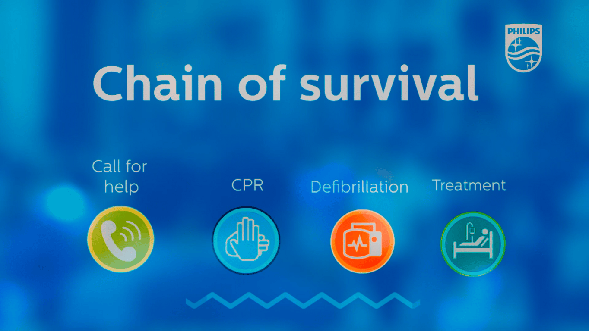

The city of Dubai setup a 3-digit emergency service number to report cardiac arrests which was followed by a sustained citizen awareness campaign. The city also trained 10,000 citizen volunteers and police personnel to perform CPR and installed over 10,000 AEDs evenly distributed across the city and high foot-fall areas.

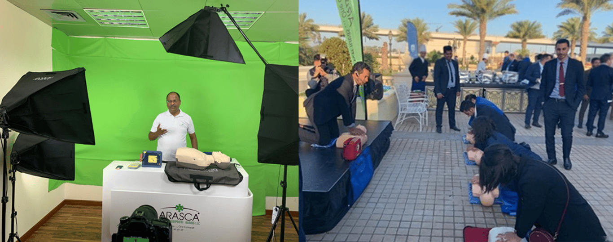

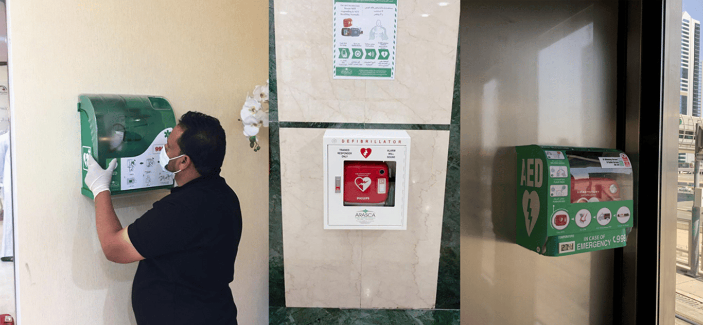

When a cardiac arrest is detected on the street, people can report the incident using the toll-free number or special SOS button on all Dubai city apps. The backend system alerts volunteers/police personnel who are close to the incident location and directs the first person who responds to the location of the incident and the second person to the nearest AED.

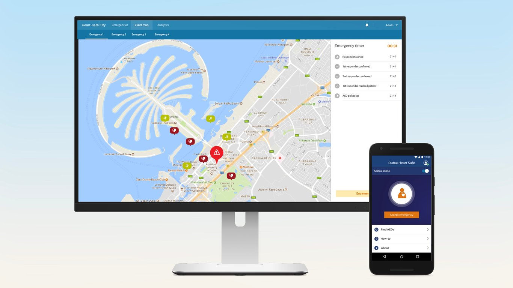

The trained first responder stabilizes the patient while the second responder reaches the spot with the AED. The system also alerts the nearest ambulance to reach the spot and the closest hospital to prepare for the patient’s arrival. This ensures that the patient gets the timely attention within the golden hour of the the incident which dramatically increases their chances of survival.

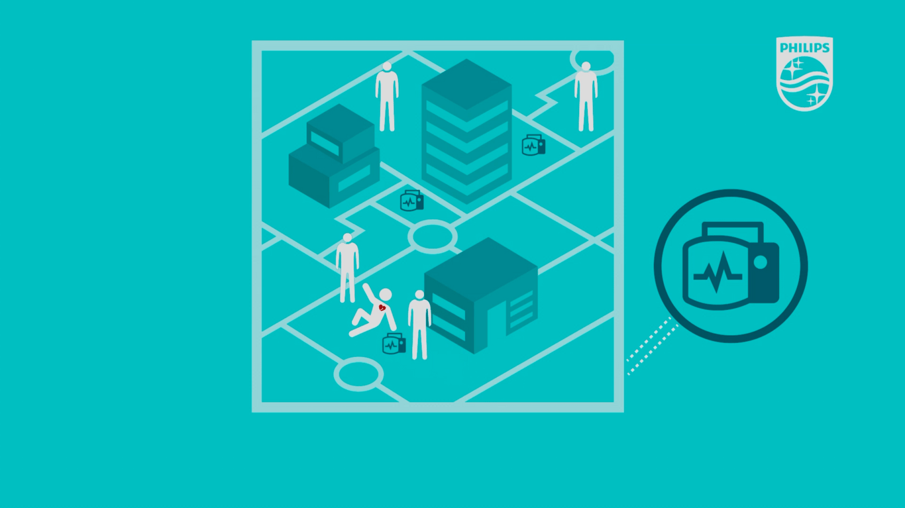
:::
::::

::::columns
:::column{width="0.1875"}
## Process
:::

:::column{width="0.8125"}
The biggest challenge of the project was to manage the diverse set of external and internal stake-holders and making sure that suggestions and changes were captured in the final design. To ensure that success of the project, I was involved in aspects officially outside my scope as a designer. My chief contributions to the project were as follows:

### <u>Mapping the Customer journey</u>:

I was responsible for bringing together the internal stakeholders spread across three continents and the Dubai City Authorities. Through a series of design sprints, remote brainstorming sessions, and user interviews, we created the primary user journey that would act as the primary document which would be then shared with different civic organizations (Dubai Police, Health Services, Municipal and Tourism Board)  to act as a template for defining the roles and responsibilities of different teams.

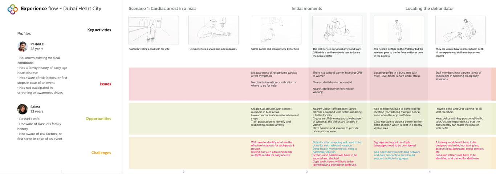

### <u>Defining ‘hero’ User flows</u>:

I worked with the internal stakeholder team to define the user flows of the first working prototype that would help Philips land the deal.

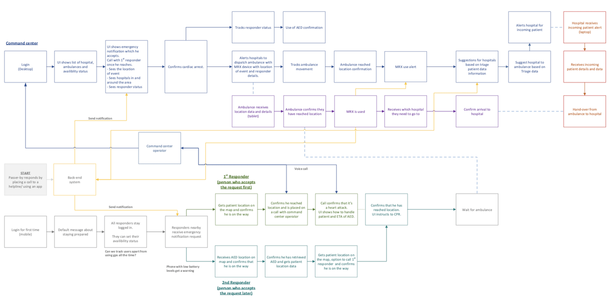

### <u>Designing mobile and web touch-points</u>:

I worked with the internal engineering team and designed the web and desktop touch-points that was later demonstrated to the Authorities of the City of Dubai and other cities in the Middle-East.

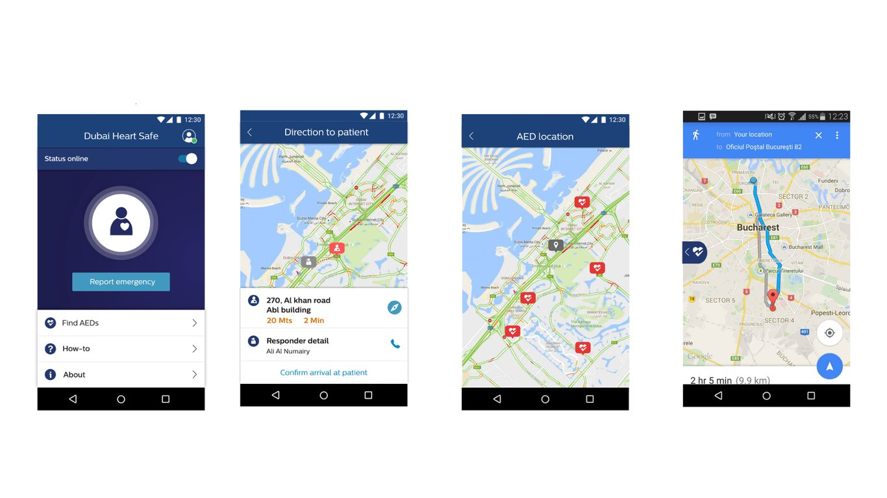

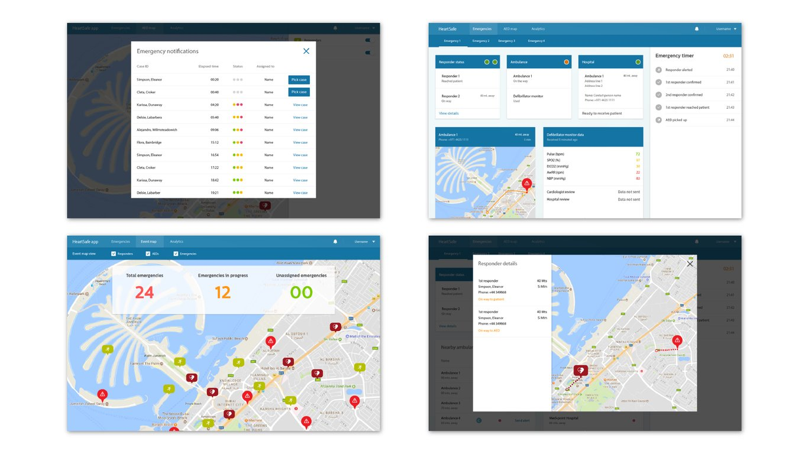

### <u>Product pitch and storytelling</u>:

While working on the UI, I collaborated with the Marketing and Sales teams to define a script that they would use for presenting the project to prospective stake-holders. The script and my designs were used for pitching to various cities in the middle-easy at Arab Health 2018 and an MOU was signed between the authorities of Dubai and Philips.

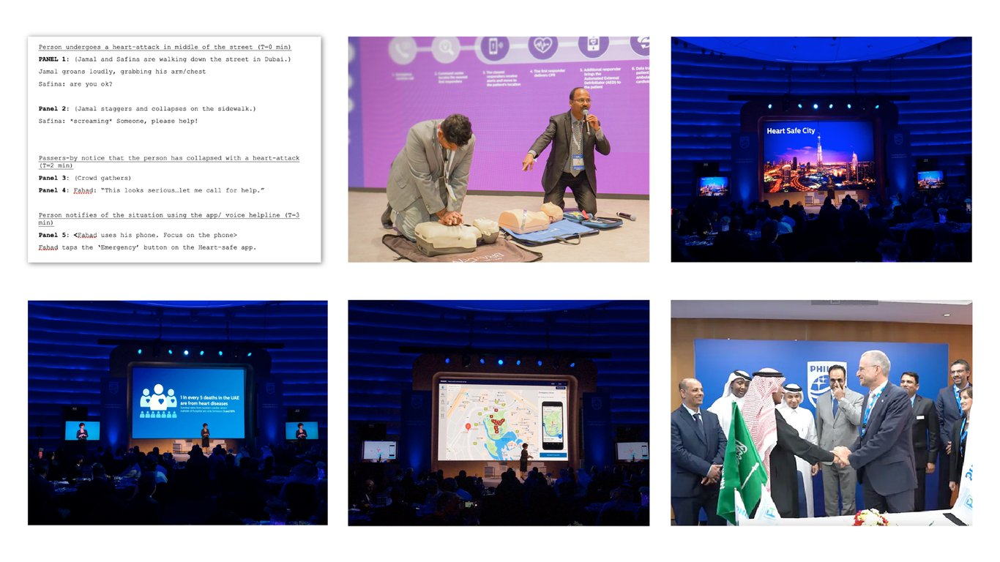
:::
::::
