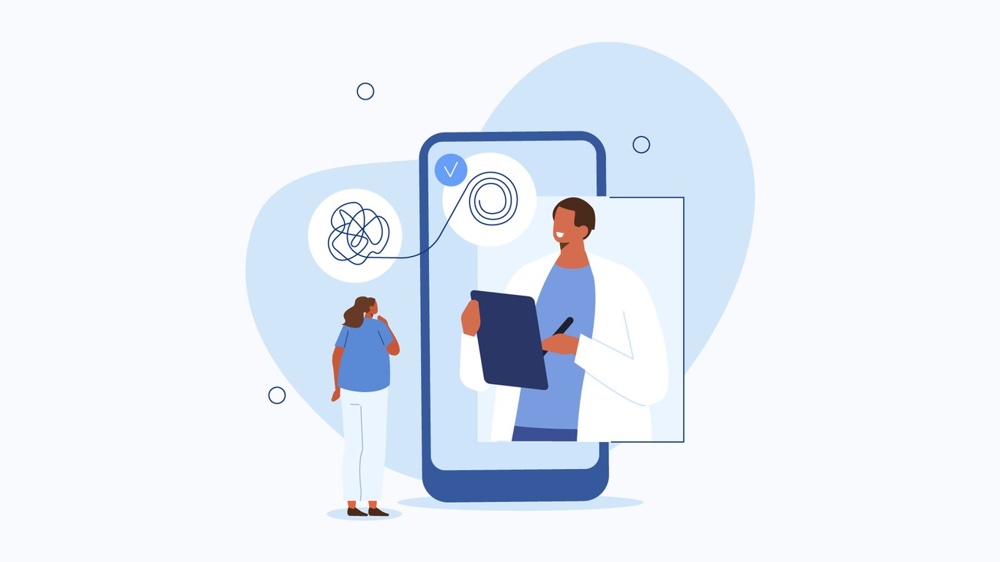
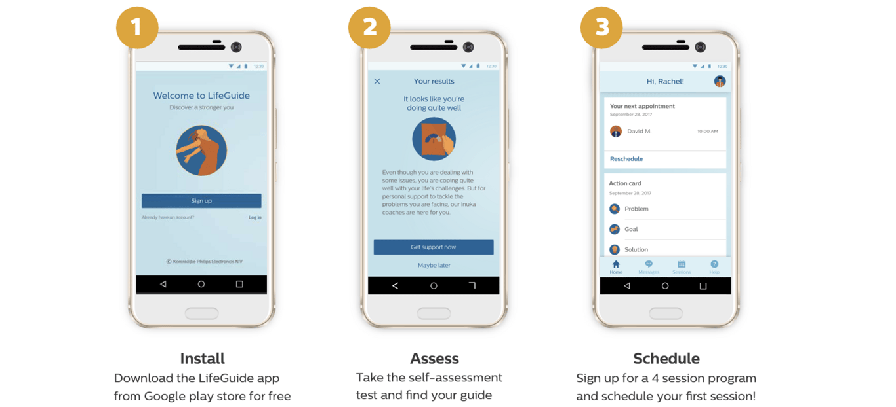
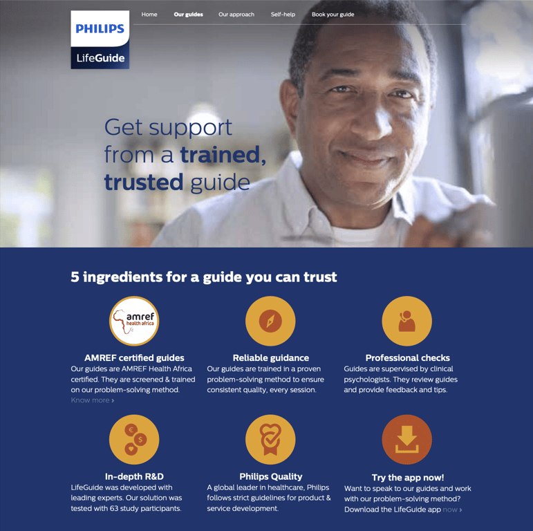
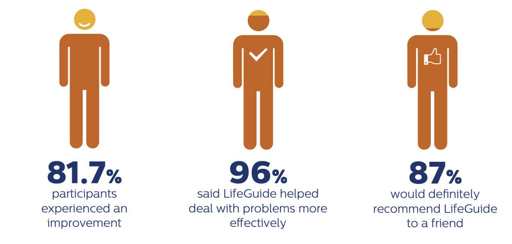
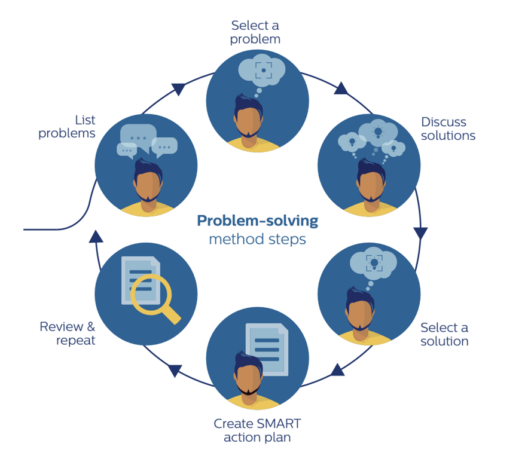
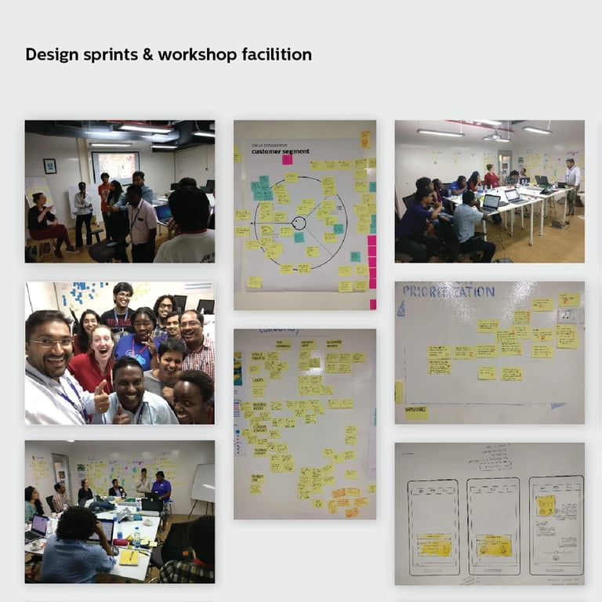
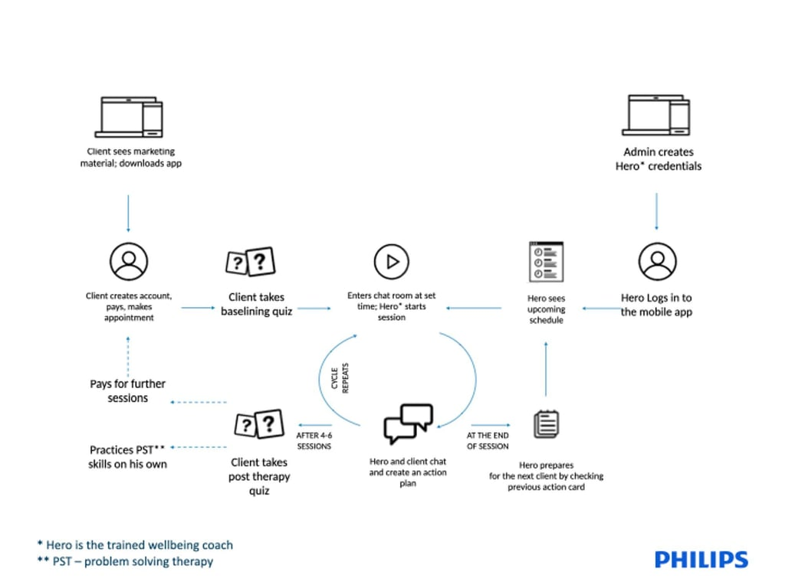
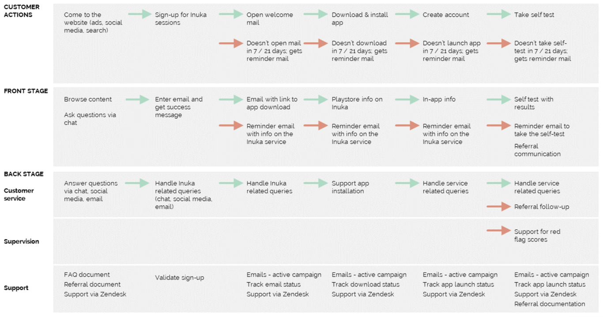
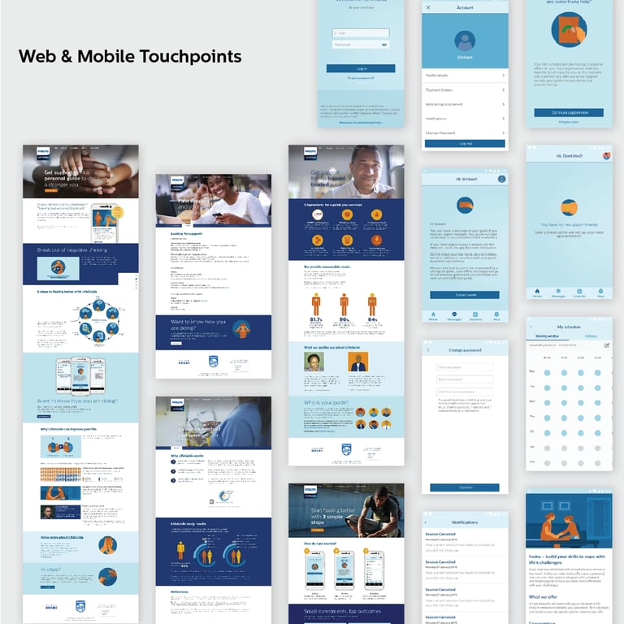

# Philips Life-Guide: Mental health coaching

July 2016 - March 2018

::::columns
:::column{width="0.1875"}
## Overview
:::

:::column{width="0.8125"}
Sub-Saharan Africa has the largest care gap for common mental disorders globally, heralding the use of digital approaches such as task-shifting and mobile technologies as viable approaches for expanding the mental health workforce. Philips Life-guide is a digital solution where counseling and therapy is delivered by community health volunteers (CHVs) through a mobile application in Kenya. Life-guide started as a research and development project within Philips, funded by [Grand Challenges Canada](https://www.grandchallenges.ca/).

:::
::::

---

::::columns
:::column{width="0.1875"}
## My role
:::

:::column{width="0.8125"}
I joined the team as a senior UX designer and worked with the creative lead to help validate the proposition with Indian/African audiences. Based on the findings, I led the UX design of the mobile app that was used to validate the product offering by conducting a longitudinal study over 3 months.

<u>Role</u>:  UX/UI design, Concept development, Usability evaluation.

<u>Team</u>: 2 business development leads, 2 designers, 10+ engineers.
:::
::::

::::columns
:::column{width="0.1875"}
## Outcome
:::

:::column{width="0.8125"}
The first version of the app was successful at demonstrating that counseling services over mobile and text in low resource settings was desirable and effective for the end users. The results of the longitudinal study enabled the team to secure seed funding and it transitioned out of Philips as an independent startup called [Inuka](https://inukacoaching.com/).

:::
::::

::::columns
:::column{width="0.1875"}
## How it works
:::

:::column{width="0.8125"}
The app has a free self-assessment test which enables users to check their mental health status anywhere, anytime, anonymously. Based on the risk-level they are connected to community health volunteers. The coaching program consists of structured Problem solving therapy (PST) sessions that are delivered to clients through a text-based chat on a mobile-app. The intervention follows the structure of a low-intensity face-to-face PST intervention, which has in recent years been adapted to be delivered by non-specialist workers for the treatment of CMDs across a range of populations in the African and Asian continent.

The coach helps the client identify a set of problems that are negatively impacting their mental health. Through a process of empathic listening, coaches attempted to gain an understanding of the client's problems across a range of different domains (e.g. work, wellbeing, relationships, financial, physical or spiritual). The coach demonstrates empathic and attentive listening through asking clarifying questions, validating the client's experiences, and through summarizing the client's problems under a list called SMART action plan. The coach will then help the client to brainstorm solutions to their problem. The final step involves evaluating the success of the action plan, which typically takes place in the second session.
:::
::::

::::columns
:::column{width="0.1875"}
## Process
:::

:::column{width="0.8125"}
The biggest challenge of the project was that the project was an early-stage start-up inside a big company. As a designer, I had to break out of my defined role and work on aspects of product strategy, roadmap, training, and tech support as and when required. The design process also had to be responsive to the shifting needs of business and my chief contributions to the project were as follows:

<u>Defining product value proposition</u>:

I worked with the creative lead and business team to assist design sprints that helped define the product proposition and assisted in planning, facilitating and creating reports.

<u>System/service design:</u>

I lead the process of converting the findings from the exploratory workshops and user research into a user flow for the MVP in consultation with technical architect and business. This helped the engineering team to scope the project and define key milestones.

<u>Defining the User Experience flow</u>:

I worked in consultation with business and creative lead to define the user experience flow that served as a template for defining criteria for acceptance and criteria of acceptance for engineering.

<u>Designing mobile and web touch-points</u>:

I led the experience and interface design for the mobile app to ensure that it aligned with the business goals and the Philips design system. I also led the process to conduct user research with the coaches using the prototype and integrate their feedback in the next version of the app.

:::
::::
