# Mobile Obstetrics Monitoring

August 2015 - May 2018

::::columns
:::column{width="0.1875"}
## Overview
:::

:::column{width="0.8125"}
Providing expectant mothers with enhanced care to address maternal mortality is a top priority for many communities. Philips Mobile Obstetrics Monitoring (MOM) is a software solution that helps unite information and action to identify and manage a high-risk pregnancy by bringing care to where it’s urgently needed: primary health centers and patient homes. MOM empowers community caregivers to capture vital information during home visits, enabling antenatal risk stratification, diagnostic assistance, and progress assessment through mobile applications.

::embed{src="https://www.youtube.com/embed/Y67AMFslTWA?feature=oembed" ratio="56.20608899297424"}

---
:::
::::

::::columns
:::column{width="0.1875"}
## My role
:::

:::column{width="0.8125"}
I was the lead designer on the project team that converted the research prototype into a software solution that was integrated with the larger ecosystem of Philips’ digital offerings. I worked on understanding the impact of the product roadmap and architecture choices on the user experience and design a solution that would scale in the years to come. I also mentored junior designers on to the team and scoped work for them on different parts of the product.

<u>Role</u>:  UX/UI design, User research, mentoring junior designers.

<u>Team</u>:  3 designers, 2 Product lead, 20+ engineers.
:::
::::

::::columns
:::column{width="0.1875"}
## Outcome
:::

:::column{width="0.8125"}
Philips Mobile Obstetrics Monitoring solution was deployed across multiple communities in South-East Asia and has proven to effectively improve maternal mortality ratios.

<u>Key Results</u>:

- 
- 
- 

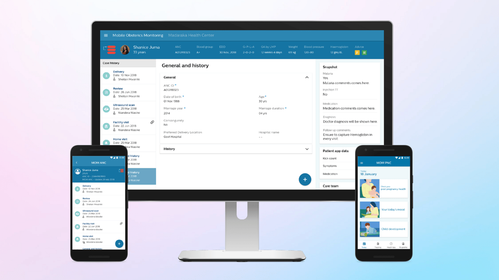
:::
::::

::::columns
:::column{width="0.1875"}
## How it works
:::

:::column{width="0.8125"}
- 
- 
- 
- 

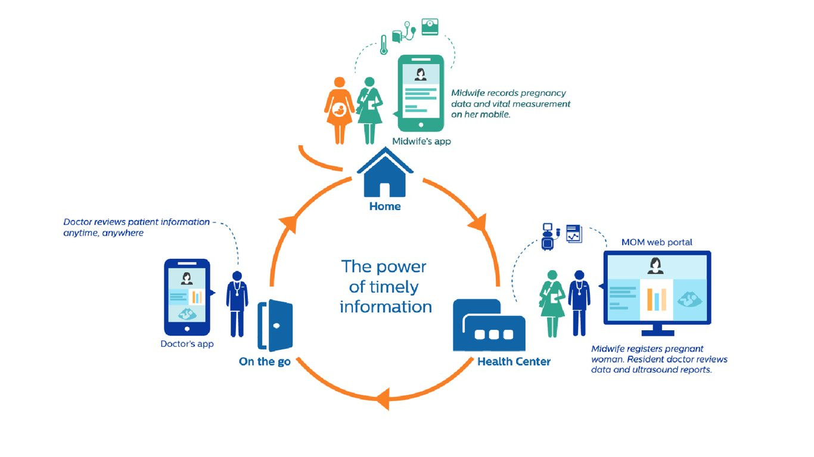

Midwives access the MOM application via mobile phone; Ob-Gyns access the application with either a laptop or cell phone. MOM allows Ob-Gyns and midwives to review patient files together and decide on an appropriate course for management of each case, not only easing the decision-making process of patient management but also encouraging timely referral to appropriate healthcare centers for further management if needed.

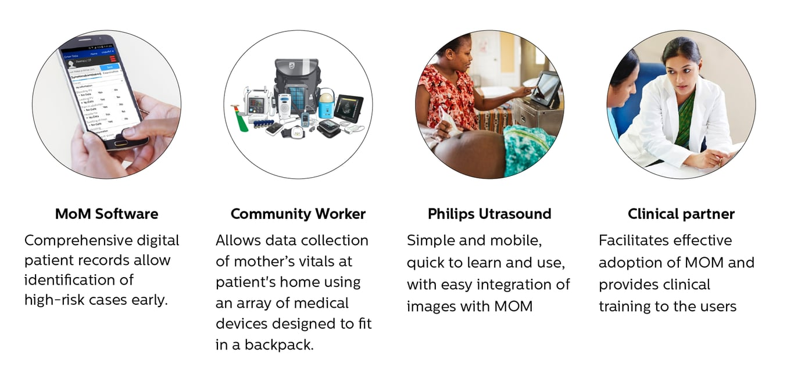
:::
::::

::::columns
:::column{width="0.1875"}
## Process
:::

:::column{width="0.8125"}
The biggest challenge of the project was to condense the multi-year timeline and technology architecture of the software solution  into a UX framework that was aligned with the larger ecosystem of Philips software products. To ensure success of the project, I had to work with design leads across different business units to harmonize the user experience, align with the design systems team to make sure that their recommendations were sensitive to the mental models of users from South East Asia.

<u>Prioritizing Product features</u>:

Working with the technical architects and product owners, I finalized a list of features that had the highest priority and were mission-critical to success. This list gave the design team enough visibility to start creating low-fidelity wireframes to define the navigation of the software solution and align on interaction patterns with  designers from products of other teams.

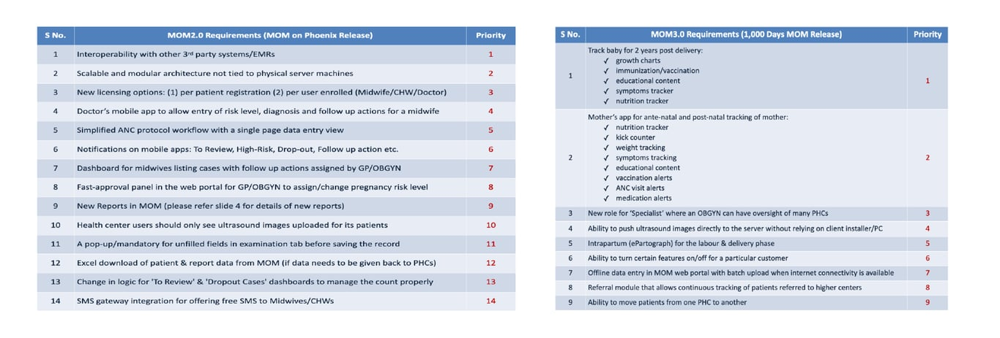

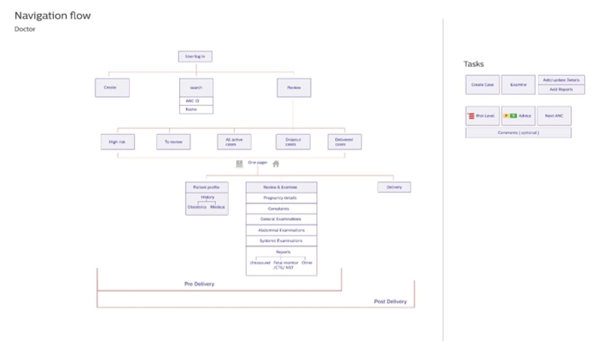

<u>Technology Impact Analysis</u>:

I worked with the technical architects to understand the specifics of how the new technology framework and the FHIR 4.0 protocol will impact the user experience. Since broadband was limited, we made a test app that helped illustrate the points at which user data could be saved on local devices and when data needed to be fetched so that designers could consider the edge-cases while defining the navigation and layout of the app.

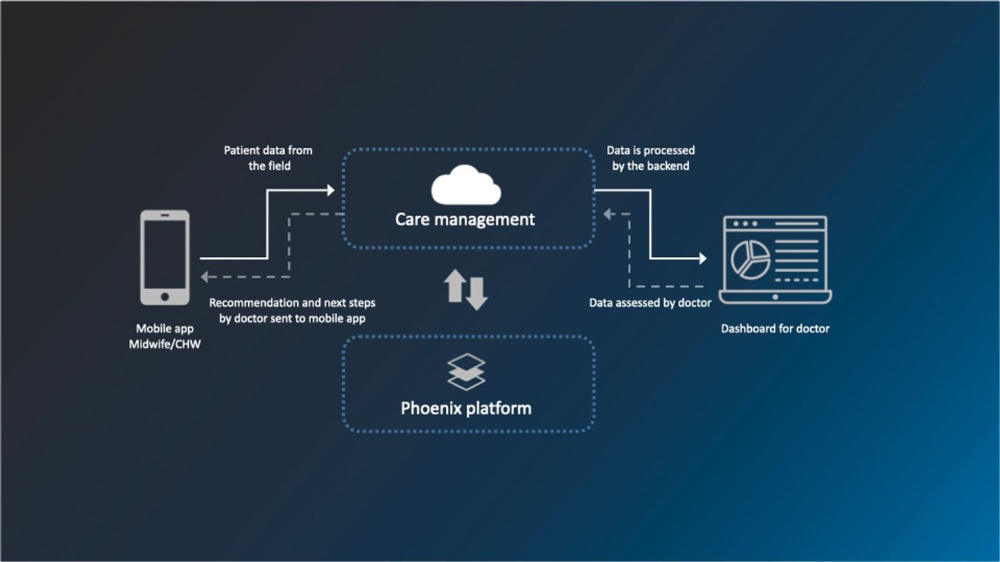

<u>Defining the User Experience flow</u>:

I worked with the business owners to define the user experience flow of the doctors and midwives which would serve as the north-star for usability testing, evaluating technical milestones and defining criteria for acceptance.

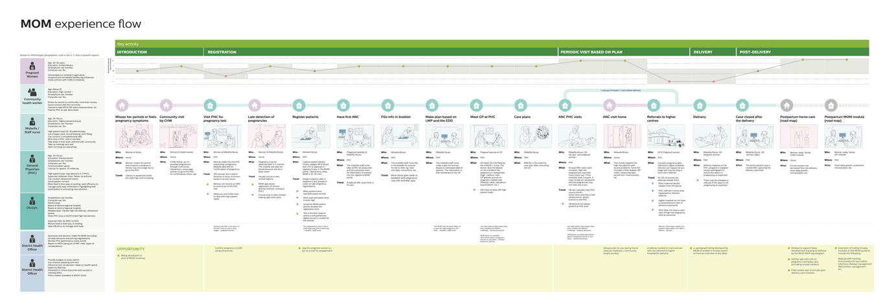

<u>Incorporating insights from the field</u>:

Through extensive user research and remote observations, the team was able to collect insights on how the current prototyping was serving the end-users and helped identify the gaps in the user experience.

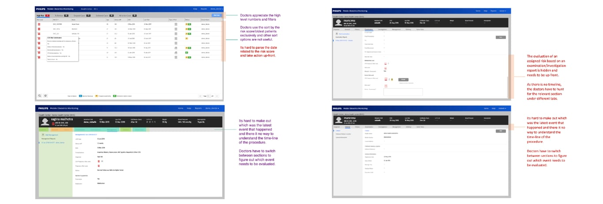

<u>Designing mobile and web touch-points</u>:

I designed the key screens of the mobile and user experience and aligned with teams from business, design systems, other business units and engineering to create consensus on the way forward. Once this was achieved, I mentored junior designers on the team to deliver on these screens and worked with engineering to ensure that the final deliverable was as per the standards set by the design team.

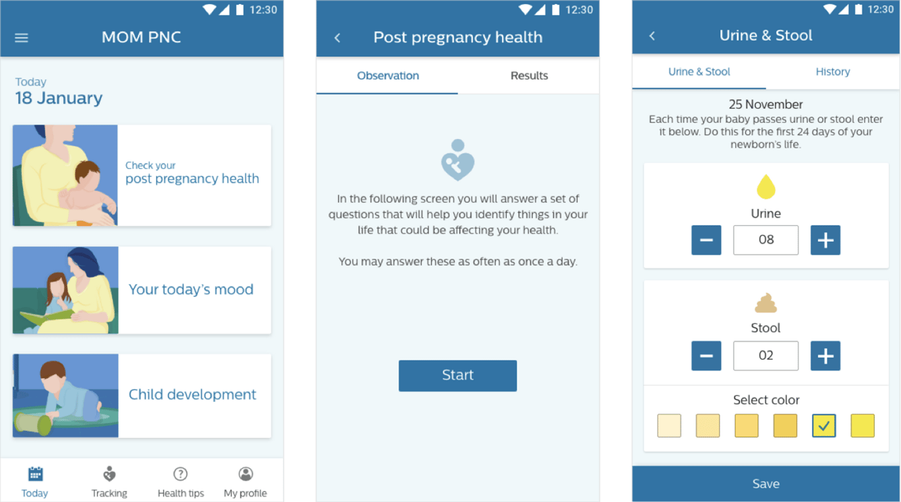

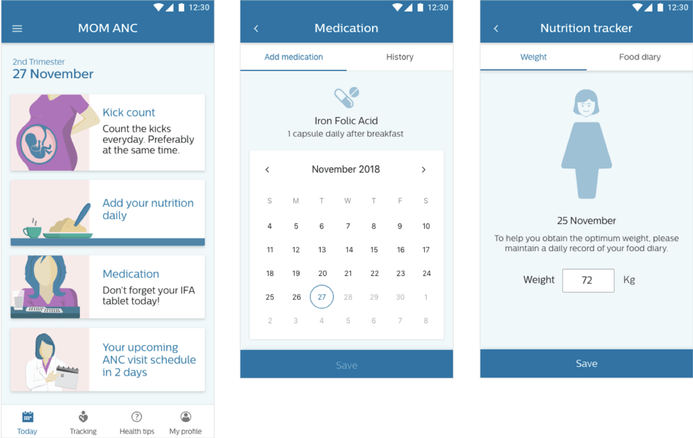

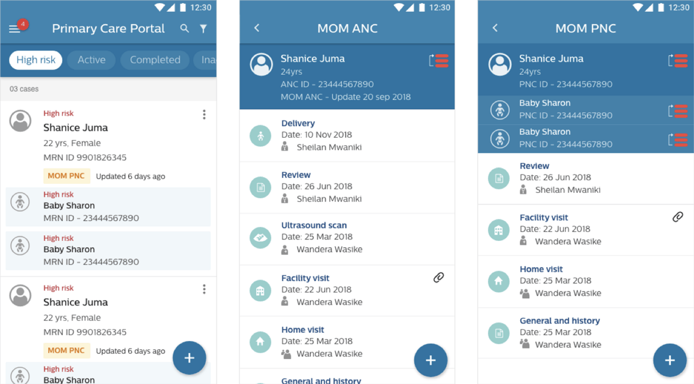

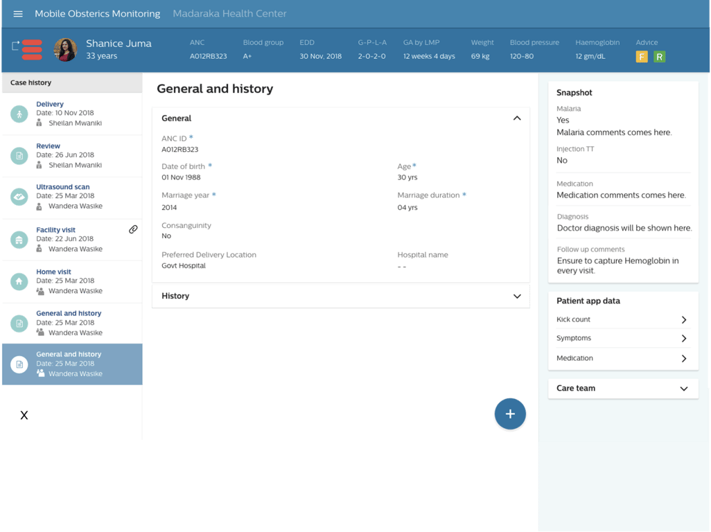

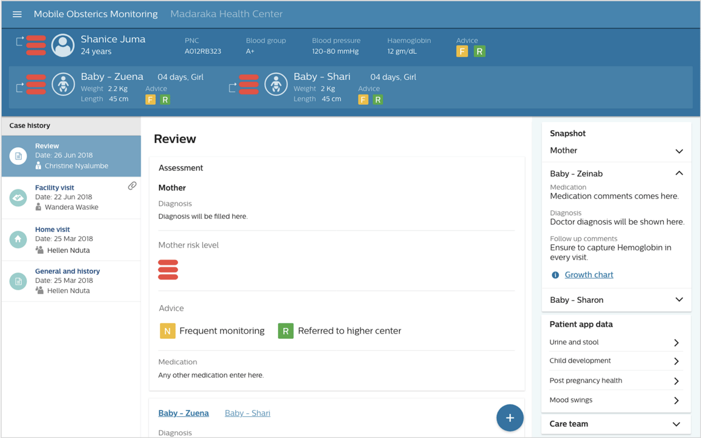

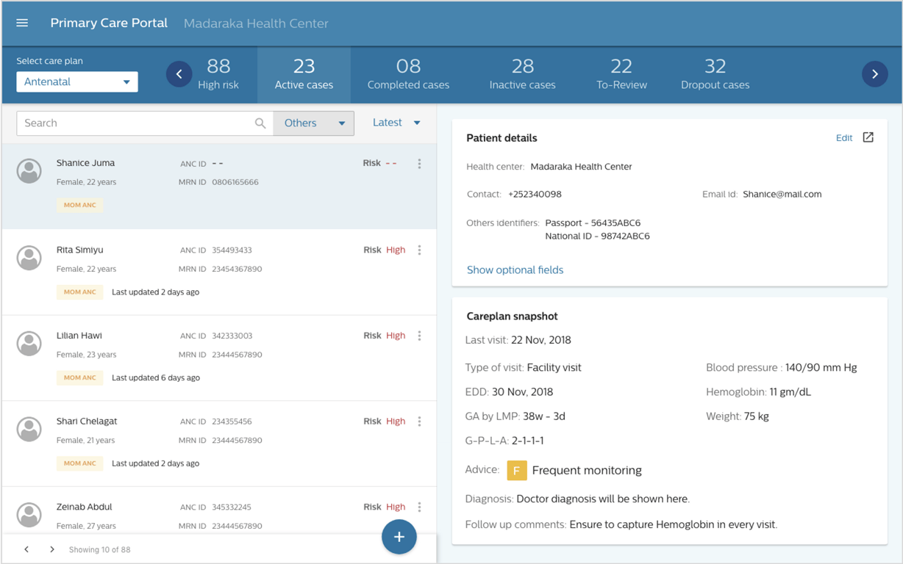
:::
::::
